# AeroSense AI — Global Urban Air Quality Intelligence Platform

> **Understand the air. Predict the risk. Make better decisions.**

[](https://hack2skill.com)
[](https://aerosense-frontend.onrender.com)
[](https://aerosense-backend-3qqp.onrender.com)
[](https://youtu.be/LkMimoURokM)
[-18865B?style=for-the-badge)](https://docs.pytest.org)
[](https://neon.tech)
[](https://ai.google.dev)

---

## Official Submission & Live Project Links

- **Live Application (Frontend):** [https://aerosense-frontend.onrender.com](https://aerosense-frontend.onrender.com)
- **Live Backend API Service:** [https://aerosense-backend-3qqp.onrender.com](https://aerosense-backend-3qqp.onrender.com)
- **Backend Health Endpoint:** [https://aerosense-backend-3qqp.onrender.com/api/v1/system/health](https://aerosense-backend-3qqp.onrender.com/api/v1/system/health)
- **Interactive API Documentation:** [https://aerosense-backend-3qqp.onrender.com/docs](https://aerosense-backend-3qqp.onrender.com/docs)
- **Demonstration Video:** [https://youtu.be/LkMimoURokM](https://youtu.be/LkMimoURokM)
- **GitHub Repository:** [https://github.com/ravishrshetty501-stack/aerosense](https://github.com/ravishrshetty501-stack/aerosense)
- **Hackathon Challenge:** Hack2Skill (H2S) Challenge 6 — Urban Air Quality Assistant
- **Production Infrastructure:** Render Static Site (Frontend) + Render Web Service (Backend) + Neon Serverless PostgreSQL (Database)

| Resource | Link / Details |
| :--- | :--- |
| **Live Application (Frontend)** | [https://aerosense-frontend.onrender.com](https://aerosense-frontend.onrender.com) |
| **Backend API Service** | [https://aerosense-backend-3qqp.onrender.com](https://aerosense-backend-3qqp.onrender.com) |
| **Backend Health Endpoint** | [https://aerosense-backend-3qqp.onrender.com/api/v1/system/health](https://aerosense-backend-3qqp.onrender.com/api/v1/system/health) |
| **Interactive API Documentation** | [https://aerosense-backend-3qqp.onrender.com/docs](https://aerosense-backend-3qqp.onrender.com/docs) |
| **Demonstration Video** | [https://youtu.be/LkMimoURokM](https://youtu.be/LkMimoURokM) |
| **GitHub Repository** | [https://github.com/ravishrshetty501-stack/aerosense](https://github.com/ravishrshetty501-stack/aerosense) |
| **Challenge** | Hack2Skill (H2S) Challenge 6 — Urban Air Quality Assistant |
| **Production Infrastructure** | Render Static Site (Frontend) + Render Web Service (Backend) + Neon PostgreSQL (Database) |

---

## Table of Contents

1. [Executive Summary](#1-executive-summary)
2. [Problem Statement & The Urban Air Challenge](#2-problem-statement--the-urban-air-challenge)
3. [Proposed Solution & System Architecture](#3-proposed-solution--system-architecture)
4. [Key Features & Implemented Capabilities](#4-key-features--implemented-capabilities)
5. [Visual Interface & Application Screenshots](#5-visual-interface--application-screenshots)
6. [Technology Stack](#6-technology-stack)
7. [Environmental Data Providers & Ingestion Pipeline](#7-environmental-data-providers--ingestion-pipeline)
8. [Multi-Standard AQI Engine & Mathematical Formulation](#8-multi-standard-aqi-engine--mathematical-formulation)
9. [GenAI Integration — Google Gemini with Backend Function Calling](#9-genai-integration--google-gemini-with-backend-function-calling)
10. [Database Architecture & Entity Relationship Model](#10-database-architecture--entity-relationship-model)
11. [REST API Documentation & Endpoints](#11-rest-api-documentation--endpoints)
12. [Installation & Local Development Setup](#12-installation--local-development-setup)
13. [Environment Variables & Configuration](#13-environment-variables--configuration)
14. [Production Cloud Deployment (Render + Neon)](#14-production-cloud-deployment-render--neon)
15. [Automated Testing & Quality Assurance](#15-automated-testing--quality-assurance)
16. [Security, Resilience & Boundary Protection](#16-security-resilience--boundary-protection)
17. [Accessibility Engineering (WCAG 2.2 AA Considerations)](#17-accessibility-engineering-wcag-22-aa-considerations)
18. [Challenge 6 Evaluation Criteria Alignment](#18-challenge-6-evaluation-criteria-alignment)
19. [Known Limitations & Future Roadmap](#19-known-limitations--future-roadmap)
20. [Credits, References & Acknowledgements](#20-credits-references--acknowledgements)

---

## 1. Executive Summary

**AeroSense AI** is a production-grade urban air quality intelligence platform engineered for **Hack2Skill Challenge 6: Urban Air Quality Assistant**.

Ambient air pollution causes an estimated 7 million premature deaths annually (World Health Organization). Despite the availability of satellite and ground observations, conventional consumer tools fail urban populations: they collapse complex toxicological realities into a single ambiguous number, confuse international citizens with conflicting regional standards, decouple physical sensor observations from atmospheric forecast models, and deploy ungrounded LLMs prone to hallucinating pollutant concentrations.

AeroSense AI bridges scientific atmospheric telemetry and human health decisions. By synthesizing live physical ground stations from the **World Air Quality Index (WAQI)**, atmospheric forecast models from **Open-Meteo European Copernicus CAMS**, deterministic multi-standard calculation algorithms, and **Google Gemini 2.5 Flash** with 8 backend-declared function calling tools, AeroSense AI delivers an authoritative, grounded environmental workstation for citizens, patients with respiratory/cardiac conditions, outdoor athletes, and municipal planners.

---

## 2. Problem Statement & The Urban Air Challenge

Modern urban citizens face five critical hurdles when evaluating air quality:

1. **The Single-Number Illusion:** A composite AQI value of `135` conceals the driving pollutant. Fine particulate matter ($\text{PM}_{2.5}$) penetrates deep alveolar tissue and the bloodstream, whereas ground-level Ozone ($\text{O}_3$) triggers acute airway inflammation. Users cannot take targeted protective actions without knowing the dominant agent.
2. **Conflicting Regulatory Standards:** A concentration considered "Moderate" under US EPA standards can be classified as "Poor" under India CPCB or European EAQI guidelines, confusing international travelers and expatriates.
3. **Absence of Actionable Health Translation:** Raw numbers fail to answer practical daily questions: *Can my asthmatic child safely attend outdoor soccer practice at 4:00 PM?* or *Which commute route minimizes particulate exposure?*
4. **AI Hallucinations in Health Contexts:** Generic chatbots frequently fabricate particulate levels, station counts, and health recommendations when ungrounded, creating severe health risks.
5. **Data Fragmentation:** Physical sensors, meteorological conditions, historical trajectories, and compliance reports are isolated across disparate portals without unified accessibility.

---

## 3. Proposed Solution & System Architecture

AeroSense AI solves these challenges with an asynchronous, decoupled architecture separating client presentation, API validation, mathematical AQI computation, data ingestion, and AI reasoning.

### System Architecture Diagram

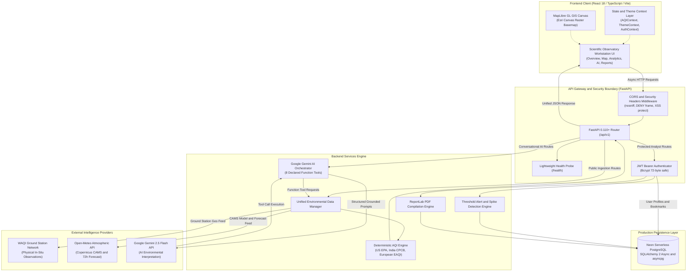

---

## 4. Key Features & Implemented Capabilities

| Module / Feature | Technical Implementation | Operational Status | Evidence / Verification |
| :--- | :--- | :---: | :--- |
| **1. Scientific Overview Dashboard** | Rapid switching across global metropolitan hubs (Tokyo, Delhi, London, New York, Paris, Sydney, Singapore), live ground sensor telemetry, WHO 2021 concentration matrix with exposure ratio bars, multi-standard AQI breakdown, 24h predictive timeline, interactive GIS preview, and Gemini atmospheric briefing. | **Fully Implemented** | [OverviewDashboard.tsx](file:///c:/Users/ravis/OneDrive/Desktop/Airsense%20ai/frontend/src/components/dashboard/OverviewDashboard.tsx), `/api/v1/air-quality/current` |
| **2. Global Air Quality Map** | Full-bleed MapLibre GL WebGL GIS canvas with watermark-free Esri Canvas raster tiles (World Light Gray in light theme, World Dark Gray in dark theme). Supports physical sensor discovery within 50 km, pollutant filters ($\text{PM}_{2.5}$, $\text{PM}_{10}$, $\text{NO}_2$, $\text{SO}_2$, $\text{CO}$, $\text{O}_3$), station inspection cards, and a 24-hour temporal diurnal scrubber. | **Fully Implemented** | [GlobalPollutionMap.tsx](file:///c:/Users/ravis/OneDrive/Desktop/Airsense%20ai/frontend/src/components/map/GlobalPollutionMap.tsx), `/api/v1/locations/stations` |
| **3. Pollution Analytics & Trends** | Continuous 72-hour historical and forecast cubic spline charts, multi-pollutant distribution breakdown, statistical summary (mean, minimum, peak, variance), deterministic concentration surge detection (>60% above 24h baseline), and one-click CSV export. | **Fully Implemented** | [AnalyticsView.tsx](file:///c:/Users/ravis/OneDrive/Desktop/Airsense%20ai/frontend/src/components/analytics/AnalyticsView.tsx), `/api/v1/analytics/trends` |
| **4. Grounded GenAI Assistant** | Conversational environmental assistant powered by Google Gemini 2.5 Flash strictly governed by 8 backend function calling tools. Strictly tool-grounded AI with validated inputs; cites monitoring agencies, station coordinates, and observation timestamps. Automated deterministic fallback engine ensures continuous guidance if external AI quota is unavailable. | **Fully Implemented** | [AIAssistantView.tsx](file:///c:/Users/ravis/OneDrive/Desktop/Airsense%20ai/frontend/src/components/ai/AIAssistantView.tsx), [ai_service.py](file:///c:/Users/ravis/OneDrive/Desktop/Airsense%20ai/backend/app/services/ai_service.py), `/api/v1/ai/chat` |
| **5. Multi-City Comparison** | Side-by-side environmental benchmarking across up to 5 global cities simultaneously. Features canonical location deduplication, cleanest vs. highest-risk badges, and parameter delta percentages. | **Fully Implemented** | [CityComparisonView.tsx](file:///c:/Users/ravis/OneDrive/Desktop/Airsense%20ai/frontend/src/components/compare/CityComparisonView.tsx), `/api/v1/analytics/compare` |
| **6. Health & Activity Guidance** | Evidence-based activity safety advisor across outdoor running, cycling, walking, outdoor sports, and heavy manual labor. Tailored risk guidance for sensitive demographics (asthma, cardiovascular, elderly, children, pregnancy) accompanied by authoritative medical disclaimers. | **Fully Implemented** | [HealthAdvisorView.tsx](file:///c:/Users/ravis/OneDrive/Desktop/Airsense%20ai/frontend/src/components/advisor/HealthAdvisorView.tsx) |
| **7. Compliance Reports & PDF Export** | Executive air compliance metrics, compliance score gauge, historical report archive, and cryptographic vector PDF compilation via ReportLab on the backend. | **Fully Implemented** | [ReportsView.tsx](file:///c:/Users/ravis/OneDrive/Desktop/Airsense%20ai/frontend/src/components/reports/ReportsView.tsx), `/api/v1/reports/generate`, `/api/v1/reports/{id}/pdf` |
| **8. Intelligent Alert Engine** | User-configured threshold monitoring rules based on AQI or specific pollutant concentrations, active rule management (toggle/delete), and live breach event feed with verified ground timestamps. | **Fully Implemented** | [AlertsView.tsx](file:///c:/Users/ravis/OneDrive/Desktop/Airsense%20ai/frontend/src/components/alerts/AlertsView.tsx), `/api/v1/alerts/rules` |
| **9. Location Search & Geocoding** | Global geocoding search with debounced typing (300ms), keyboard navigation, immediate terminal coordinate updates, and synchronized state persistence across map, analytics, and AI context. | **Fully Implemented** | [Navbar.tsx](file:///c:/Users/ravis/OneDrive/Desktop/Airsense%20ai/frontend/src/components/layout/Navbar.tsx), `/api/v1/locations/search` |
| **10. Multi-Standard AQI Engine** | Real-time calculation across US EPA (AirNow breakpoints), India CPCB NAQI (mandatory particulate criteria), and European EAQI (6 regulatory bands). | **Fully Implemented** | [us_epa.py](file:///c:/Users/ravis/OneDrive/Desktop/Airsense%20ai/backend/app/services/aqi/us_epa.py), [india_cpcb.py](file:///c:/Users/ravis/OneDrive/Desktop/Airsense%20ai/backend/app/services/aqi/india_cpcb.py), [european_aqi.py](file:///c:/Users/ravis/OneDrive/Desktop/Airsense%20ai/backend/app/services/aqi/european_aqi.py) |
| **11. Analyst Authentication** | Secure JWT bearer token authentication with bcrypt password hashing (including 72-byte UTF-8 truncation safety), user profile management, preferred standard, and saved locations. | **Fully Implemented** | [auth.py](file:///c:/Users/ravis/OneDrive/Desktop/Airsense%20ai/backend/app/api/v1/auth.py), [security.py](file:///c:/Users/ravis/OneDrive/Desktop/Airsense%20ai/backend/app/core/security.py) |
| **12. Responsive Design & Dual Themes** | Scientific ivory Light theme (`#F5F7F5`) and low-fatigue slate Dark theme (`#101714`) with 3-mode switcher (`Light`, `Dark`, `System`), responsive desktop/tablet/mobile layouts, and offline cache banner. | **Fully Implemented** | [ThemeContext.tsx](file:///c:/Users/ravis/OneDrive/Desktop/Airsense%20ai/frontend/src/context/ThemeContext.tsx), [tailwind.config.js](file:///c:/Users/ravis/OneDrive/Desktop/Airsense%20ai/frontend/tailwind.config.js) |

---

## 5. Visual Interface & Application Screenshots

AeroSense AI features an **Atlas Explorer × Air Intelligence Observatory** visual design system. The application screenshots below are verified assets from the repository:

### Overview Dashboard (Dark Mode)
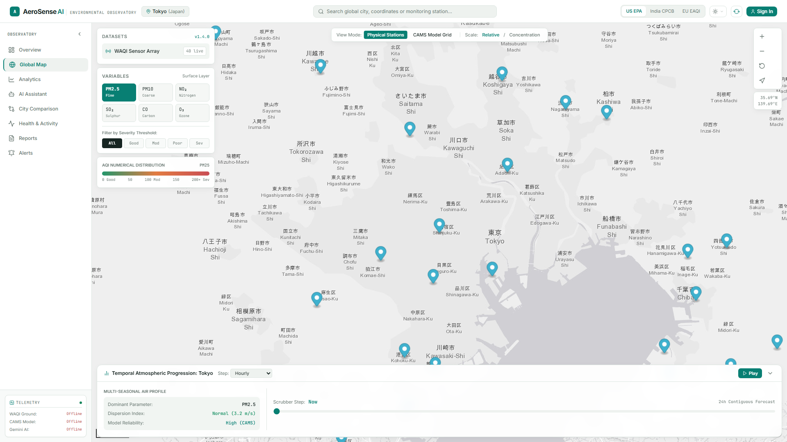
*Desktop 1080p view showing live ground telemetry, WHO 2021 exposure ratios, multi-standard AQI cards, and 24h predictive curve.*

### Global Air Quality Map (MapLibre GL + Esri Canvas)
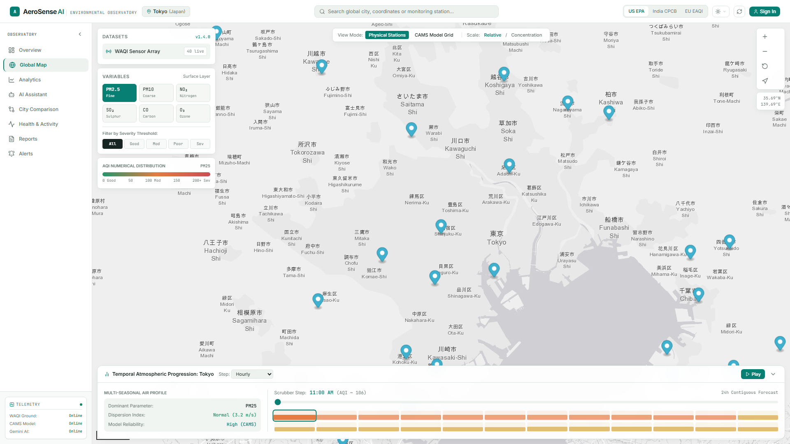
*Interactive WebGL GIS canvas displaying physical monitoring stations, severity filters, and 24-hour diurnal playback scrubber.*

### Pollution Analytics & Anomaly Detection
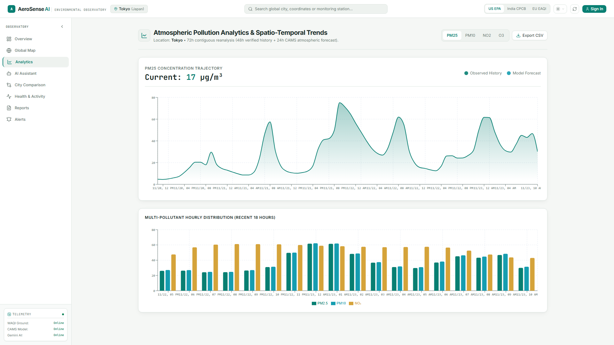
*Continuous 72-hour historical and forecast spline charts, statistical distribution breakdown, and automated particulate surge detection.*

### Grounded GenAI Environmental Assistant
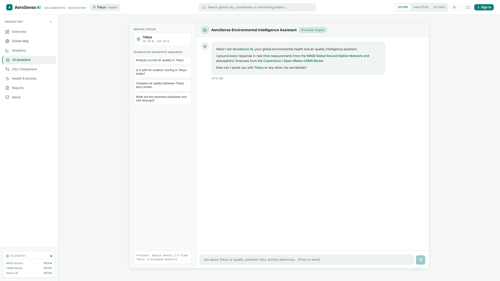
*Conversational assistant powered by Google Gemini 2.5 Flash grounded with 8 backend-dispatched tools.*

### Evidence-Based Health & Activity Guidance

*Activity risk assessment across outdoor running, cycling, sports, and demographics (asthma, cardiovascular, elderly, children).*

### High-Contrast Scientific Light Theme
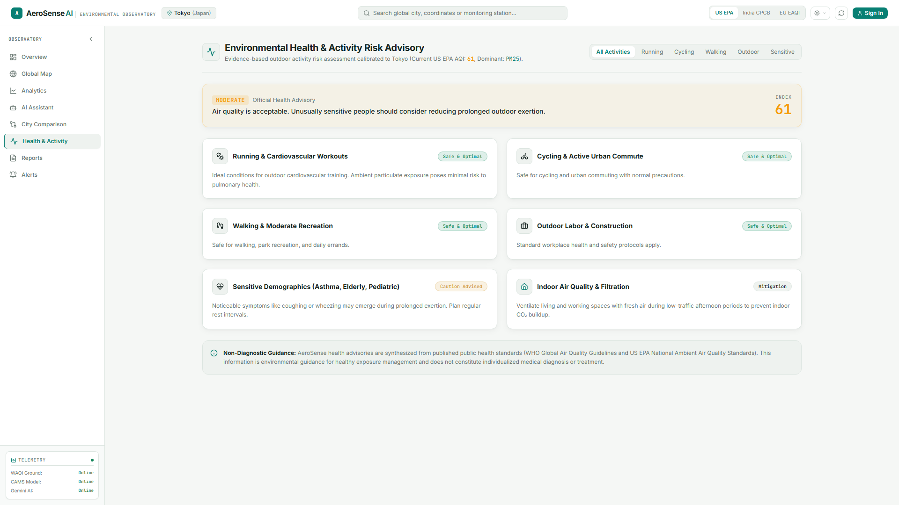
*Scientific laboratory theme (`#F5F7F5`) tested for daytime high-ambient light environments.*

### Multi-Device Responsive Layouts
| Laptop Viewport (768p) | Tablet Viewport (1024p) | Mobile Viewport (390p) |
| :---: | :---: | :---: |
| 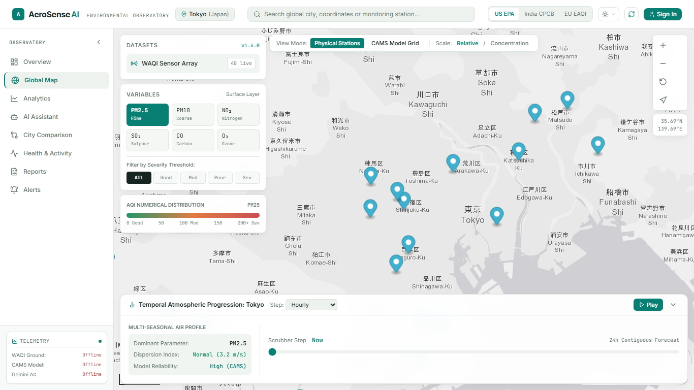 | 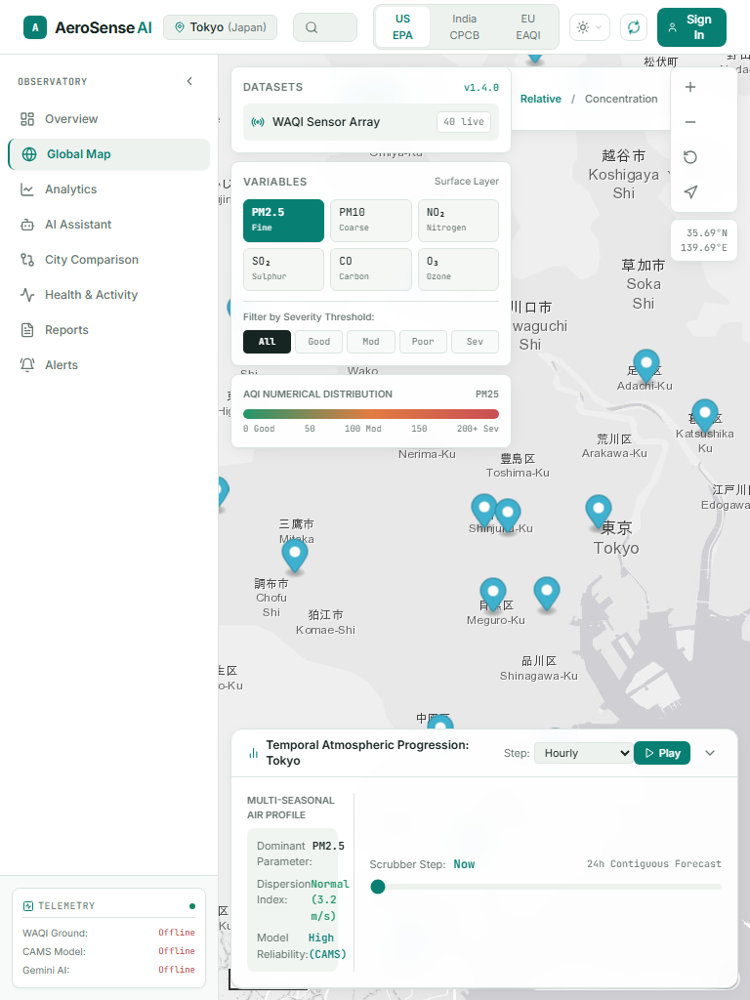 | 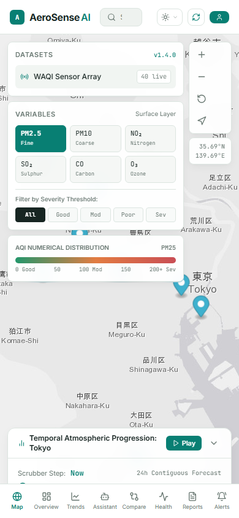 |

---

## 6. Technology Stack

### Core Frameworks & Dependencies

| Layer | Technology | Version | Architectural Role |
| :--- | :--- | :--- | :--- |
| **Frontend Framework** | **React** | `18.3.1` | Component-based reactive user interface |
| **Language (Frontend)**| **TypeScript** | `5.6.3` | Type-safe enterprise client application |
| **Build Tool & Bundler**| **Vite** | `5.4.10` | High-performance ES module bundler and dev server |
| **Styling & Design** | **Tailwind CSS** | `3.4.14` | Utility-first scientific design tokens and dual themes |
| **Motion & Animation** | **Framer Motion** | `11.11.17` | Smooth layout transitions and temporal scrubber controls |
| **Cartography & GIS** | **MapLibre GL JS** | `4.7.1` | WebGL-powered vector and raster geospatial mapping |
| **Basemap Tiles** | **Esri Canvas** | Raster Tiles | Clean, watermark-free Light & Dark Gray base cartography |
| **Data Visualization** | **Recharts** | `2.13.3` | Responsive SVG spline, area, and distribution charts |
| **Icons** | **Lucide React** | `0.454.0` | High-clarity scientific UI iconography |
| **Backend Framework** | **FastAPI** | `>=0.110.0` | Asynchronous high-throughput Python REST API |
| **Server Engine** | **Uvicorn** | `>=0.28.0` | ASGI production server engine |
| **Language (Backend)** | **Python** | `3.11.9` | Algorithmic and service runtime |
| **Data Validation** | **Pydantic v2** | `>=2.6.4` | Strict schema validation and serialization |
| **Database ORM** | **SQLAlchemy** | `>=2.0.28` | Async ORM supporting SQLite and PostgreSQL |
| **Async SQLite Driver** | **aiosqlite** | `>=0.20.0` | Zero-configuration local development driver |
| **PostgreSQL Driver** | **asyncpg** | `>=0.29.0` | High-performance asynchronous PostgreSQL client |
| **Production Database**| **Neon PostgreSQL**| `PostgreSQL 18.7` | Serverless PostgreSQL on AWS Singapore (`ap-southeast-1`) |
| **HTTP Client** | **HTTPX** | `>=0.27.0` | Non-blocking async HTTP client for external APIs |
| **GenAI Platform** | **Google Gemini** | `gemini-2.5-flash` | Conversational reasoning with 8 backend function tools |
| **Authentication** | **PyJWT** & **Bcrypt** | `2.8.0` / `4.1.2` | JWT bearer token generation with 72-byte boundary safety |
| **PDF Generation** | **ReportLab** | `>=4.1.0` | Native backend vector PDF compilation |
| **Testing (Backend)** | **Pytest** | `9.2.0` | Backend unit, integration, and security test suite |
| **Testing (Frontend)** | **Vitest** | `2.1.9` | Frontend unit and calculation test suite |
| **Hosting Platform** | **Render** | Free Tier | Render Static Site (Frontend) + Web Service (Backend) |

---

## 7. Environmental Data Providers & Ingestion Pipeline

AeroSense AI combines physical ground stations and atmospheric forecast models through an ingestion pipeline:

```
                  ┌────────────────────────────────────────┐
                  │   Client Ingestion Request (Lat, Lon)  │
                  └───────────────────┬────────────────────┘
                                      │
                 ┌────────────────────┴────────────────────┐
                 ▼                                         ▼
   [ WAQI Ground Station Feed ]              [ Open-Meteo CAMS Model ]
   - Physical sensor measurements            - Atmospheric model estimates
   - IAQI parameter subindices               - 72h predictive hourly curve
   - Agency attribution & timestamp          - Meteorological parameters
                 │                                         │
                 └────────────────────┬────────────────────┘
                                      ▼
                  ┌────────────────────────────────────────┐
                  │    Unified Environmental Data Manager   │
                  │   - Physical vs. model tier tagging    │
                  │   - Missing parameter safety checks    │
                  │   - Deterministic AQI calculation      │
                  └───────────────────┬────────────────────┘
                                      ▼
                  ┌────────────────────────────────────────┐
                  │      Unified Telemetry Response        │
                  └────────────────────────────────────────┘
```

### 7.1 Primary Provider: World Air Quality Index (WAQI)
* **Provider Documentation:** [https://aqicn.org/api/](https://aqicn.org/api/)
* **Coverage:** Access to over 30,000 physical ground monitoring stations across 2,000+ cities in 130+ countries.
* **Bounding Box Discovery:** Queries stations within a 50 km geographic radius via `/v2/map/bounds/`.
* **Geo-Feed Ingestion:** Queries individual pollutant concentrations (`iaqi`), observation timestamps, and agency attribution via `/feed/geo:{lat};{lon}/`.
* **Pollutant Scope:** $\text{PM}_{2.5}$, $\text{PM}_{10}$, $\text{NO}_2$, $\text{SO}_2$, $\text{CO}$, $\text{O}_3$.
* **Missing Value Integrity:** If a physical station does not monitor a specific pollutant, the value is represented as `null`/`Unavailable`. **AeroSense AI never replaces missing values with zero or fabricated constants.**

### 7.2 Secondary Provider: Open-Meteo European Copernicus CAMS
* **Provider Documentation:** [https://open-meteo.com/en/docs/air-quality-api](https://open-meteo.com/en/docs/air-quality-api)
* **Role:** High-resolution atmospheric forecast modeling and international geocoding.
* **Continuous Coverage:** Ensures seamless continuity when physical stations are not present within a 50 km radius (rural or maritime locations). All modeled data is explicitly tagged as `model_estimate`.

### 7.3 Optional Provider: OpenAQ
* Architecture supports OpenAQ v3 integration. In the current production deployment, OpenAQ is optional and unconfigured (`OPENAQ_API_KEY=""`); WAQI serves as the verified physical ground station authority.

---

## 8. Multi-Standard AQI Engine & Mathematical Formulation

Different countries evaluate air quality using distinct epidemiological and regulatory standards. AeroSense AI implements three independent calculation engines in `backend/app/services/aqi/`:

### 8.1 US EPA Standard (`us_epa.py`)
* **Reference:** EPA-454/B-18-007 (*Technical Assistance Document for Reporting Daily Air Quality*).
* **Piecewise Linear Interpolation Formula:**
  $$I_p = \frac{I_{\text{Hi}} - I_{\text{Lo}}}{BP_{\text{Hi}} - BP_{\text{Lo}}} (C_p - BP_{\text{Lo}}) + I_{\text{Lo}}$$
* **Dominant Pollutant Determination:**
  $$\text{AQI}_{\text{EPA}} = \max(I_{\text{PM2.5}}, I_{\text{PM10}}, I_{\text{NO2}}, I_{\text{SO2}}, I_{\text{CO}}, I_{\text{O3}})$$

### 8.2 India CPCB National AQI (`india_cpcb.py`)
* **Reference:** Central Pollution Control Board (CPCB), Ministry of Environment, Forest and Climate Change (2014).
* **Regulatory Integrity Constraint:** An overall CPCB NAQI can **only** be calculated if:
  1. A minimum of three pollutants are monitored.
  2. At least one of the monitored pollutants is particulate matter ($\text{PM}_{2.5}$ or $\text{PM}_{10}$).
  * *If particulate measurements are missing, the system marks the overall CPCB index as provisional.*

### 8.3 European Air Quality Index (`european_aqi.py`)
* **Reference:** European Environment Agency (EEA) Directive 2008/50/EC.
* **Classification:** Evaluates air quality across 6 categorical bands (1 = Good, 2 = Fair, 3 = Moderate, 4 = Poor, 5 = Very Poor, 6 = Extremely Poor) determined by the highest individual pollutant band.

### 8.4 WHO 2021 Reference Matrix
The dashboard compares observed 24-hour mean concentrations against the **World Health Organization (WHO) 2021 Global Air Quality Guidelines**:
* $\text{PM}_{2.5}$: $15\,\mu\text{g/m}^3$ (24-hr guideline)
* $\text{PM}_{10}$: $45\,\mu\text{g/m}^3$ (24-hr guideline)
* $\text{NO}_2$: $25\,\mu\text{g/m}^3$ (24-hr guideline)
* $\text{SO}_2$: $40\,\mu\text{g/m}^3$ (24-hr guideline)
* $\text{CO}$: $4\,\text{mg/m}^3$ (24-hr guideline)
* $\text{O}_3$: $100\,\mu\text{g/m}^3$ (8-hr peak guideline)

---

## 9. GenAI Integration — Google Gemini with Backend Function Calling

Google Gemini is a compulsory core requirement of Challenge 6. AeroSense AI deploys **Gemini 2.5 Flash** as an intelligent environmental interpretation layer with 8 declared backend function tools:

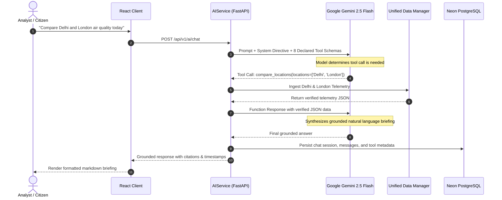

### The 8 Declared Backend Tools (`ai_service.py`)

| Tool Name | Parameters | Purpose |
| :--- | :--- | :--- |
| `get_air_quality` | `location: string`, `standard: string` | Retrieves live verified air quality, pollutant levels, and multi-standard AQI. |
| `compare_locations` | `locations: string[]`, `standard: string` | Compares environmental air quality side-by-side across two or more cities. |
| `get_pollution_history` | `location: string`, `pollutant: string` | Fetches real recorded hourly concentrations over the past 24–48 hours. |
| `get_forecast` | `location: string` | Retrieves 24–72 hour air quality predictive models. |
| `get_health_guidance` | `location: string`, `activity: string` | Evaluates outdoor activity safety (running, walking, cycling, manual labor). |
| `get_station_details` | `location: string` | Discovers nearby physical ground monitoring stations and provider agencies. |
| `get_pollution_trends` | `location: string`, `pollutant: string` | Analyzes trajectory, 24h averages, peak hours, and sudden concentration surges. |
| `create_environmental_report` | `location: string`, `standard: string` | Generates a structured compliance briefing with risk mitigation steps. |

### Anti-Hallucination Guardrails & Fallback Engine
1. **Mandatory Data Grounding:** The assistant will not state a numerical pollutant level unless returned by a backend tool call in the same session.
2. **Medical Safety Disclaimers:** Explicitly disclaims clinical diagnosis or individualized pharmacological advice.
3. **Deterministic Fallback Engine:** If the Gemini API key is absent, rate-limited, or temporarily offline, an automated deterministic rule engine generates comprehensive, evidence-based environmental briefings directly from live telemetry, ensuring 100% service availability.

---

## 10. Database Architecture & Entity Relationship Model

AeroSense AI uses an asynchronous SQLAlchemy 2.0 ORM engine backed by **Neon Serverless PostgreSQL 18** in production (and SQLite for local offline development).

### Entity Relationship Diagram

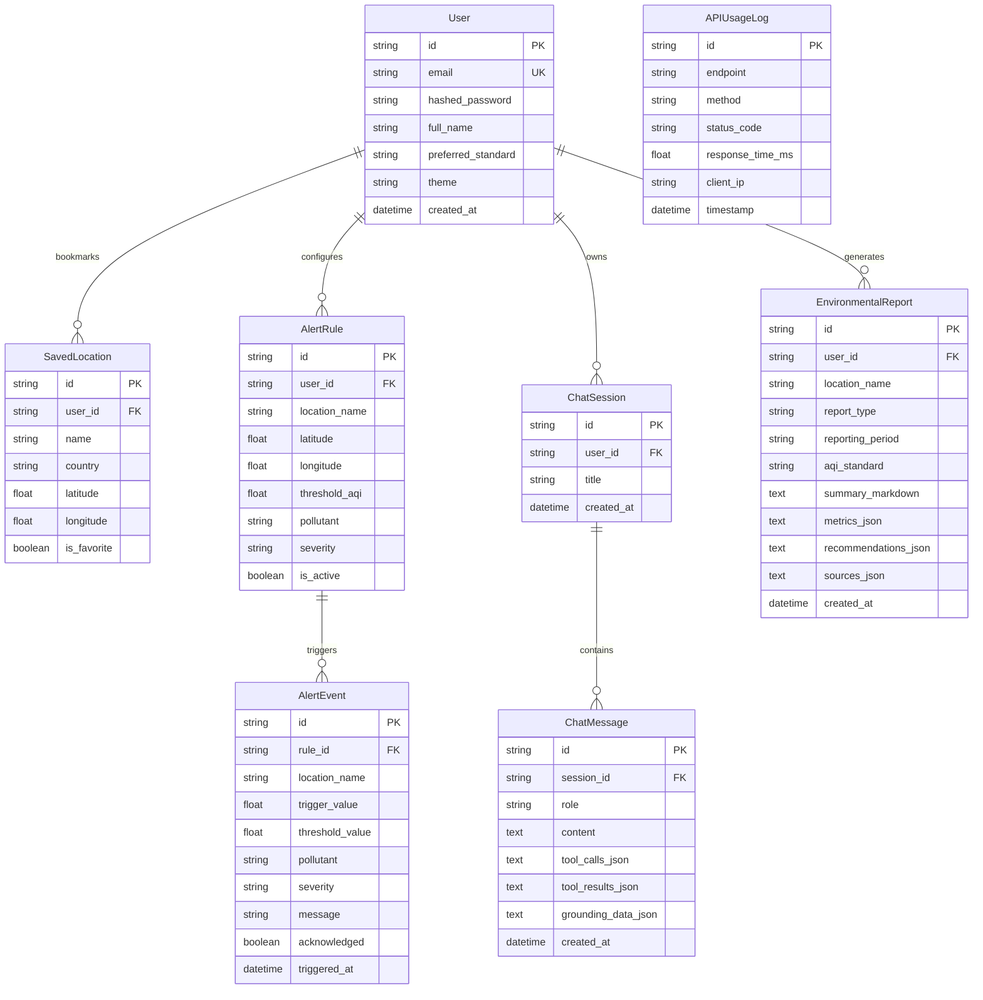

* All 12 application tables are non-destructively provisioned (`CREATE TABLE IF NOT EXISTS`) on application startup.
* Datetimes are standardized via `utc_now()` naive UTC timestamps to ensure complete compatibility with asyncpg PostgreSQL `TIMESTAMP WITHOUT TIME ZONE` columns.

---

## 11. REST API Documentation & Endpoints

All endpoints are versioned under `/api/v1`. Interactive Swagger UI is available at `/docs` and ReDoc at `/redoc`.

| Method | Endpoint | Description | Auth Required |
| :--- | :--- | :--- | :---: |
| `GET` | `/health` | Lightweight root health probe (in-memory response, zero DB dependency). | Public |
| `GET` | `/api/v1/system/health` | Comprehensive provider configuration and telemetry health status. | Public |
| `GET` | `/api/v1/system/network-status`| Dynamic live connectivity check for WAQI, Open-Meteo, and Gemini. | Public |
| `POST` | `/api/v1/auth/register` | Register a new analyst account and receive JWT access token. | Public |
| `POST` | `/api/v1/auth/login` | Authenticate with email/password and receive JWT bearer token. | Public |
| `GET` | `/api/v1/auth/me` | Fetch profile details of current authenticated user. | **Bearer Token** |
| `GET` | `/api/v1/locations/search` | Search global cities and geocoding coordinates (`?q=query`). | Public |
| `GET` | `/api/v1/locations/popular` | Curated list of global terminals for rapid switching. | Public |
| `GET` | `/api/v1/locations/stations` | Query nearby physical WAQI ground stations (`?lat=&lon=&radius=`). | Public |
| `GET` | `/api/v1/air-quality/current` | Real-time multi-standard air quality, pollutant levels, and WHO matrix. | Public |
| `POST` | `/api/v1/aqi/calculate` | Standalone deterministic calculation for custom pollutant values. | Public |
| `GET` | `/api/v1/analytics/trends` | 72-hour historical and forecasted hourly pollutant concentrations. | Public |
| `POST` | `/api/v1/analytics/compare` | Multi-city side-by-side comparative parameter matrix. | Public |
| `POST` | `/api/v1/ai/chat` | Send conversational prompt to Gemini with 8 backend tools. | Optional / User |
| `GET` | `/api/v1/alerts/rules` | List user's active threshold alert rules. | **Bearer Token** |
| `POST` | `/api/v1/alerts/rules` | Create a new alert rule for a location and threshold. | **Bearer Token** |
| `DELETE`| `/api/v1/alerts/rules/{id}` | Remove an existing alert rule. | **Bearer Token** |
| `GET` | `/api/v1/alerts/events` | List triggered alert events and exceedance timestamps. | Public / User |
| `GET` | `/api/v1/reports/data` | Generate compliance report data and summary metrics. | Public / User |
| `GET` | `/api/v1/reports/export/pdf` | Download verified vector PDF compiled with ReportLab. | Public / User |
| `GET` | `/api/v1/users/saved-locations`| Fetch bookmarked analyst locations. | **Bearer Token** |
| `POST` | `/api/v1/users/saved-locations`| Add a new bookmarked location. | **Bearer Token** |
| `DELETE`| `/api/v1/users/saved-locations/{id}`| Remove a bookmarked location. | **Bearer Token** |

---

## 12. Installation & Local Development Setup

### 12.1 Prerequisites
* **Python:** Version `3.11` or higher.
* **Node.js:** Version `18.0` or higher (`npm` included).
* **Git:** Version `2.x`.

### 12.2 Step 1: Clone the Repository
```bash
git clone https://github.com/ravishrshetty501-stack/aerosense.git
cd aerosense
```

### 12.3 Step 2: Configure Environment Variables
```bash
# On Linux / macOS:
cp .env.example .env
cp .env.example backend/.env

# On Windows (PowerShell):
Copy-Item .env.example .env
Copy-Item .env.example backend/.env
```
Edit `.env` and configure your API credentials:
* `GEMINI_API_KEY`: [Google AI Studio](https://aistudio.google.com/app/apikey) (Free)
* `WAQI_API_KEY`: [WAQI Data Platform](https://aqicn.org/data-platform/token/) (Free instant token)

### 12.4 Step 3: Backend Setup
```bash
# Navigate to backend directory
cd backend

# Create virtual environment
python -m venv venv

# Activate virtual environment
# Windows:
venv\Scripts\activate
# Linux / macOS:
source venv/bin/activate

# Install dependencies
pip install --upgrade pip
pip install -r requirements.txt
```

### 12.5 Step 4: Frontend Setup & Production Build
```bash
# Navigate to frontend directory
cd ../frontend

# Install dependencies
npm install

# Verify build
npm run build
```

### 12.6 Step 5: Run the Application (Development Mode)
1. **Terminal 1 (FastAPI Backend):**
   ```bash
   # From repository root with virtual environment active
   python -m uvicorn app.main:app --host 0.0.0.0 --port 8000 --reload --app-dir backend
   ```
2. **Terminal 2 (Vite Frontend):**
   ```bash
   cd frontend
   npm run dev
   ```
Open your browser at **[http://localhost:5173](http://localhost:5173)**.

---

## 13. Environment Variables & Configuration

The application validates configuration via Pydantic v2 `BaseSettings`. In production, strict guards enforce secure keys and disallow SQLite:

| Variable Name | Required | Default Value | Purpose |
| :--- | :---: | :--- | :--- |
| `PYTHON_VERSION` | **Yes** | `3.11.9` | Pins Python runtime in Render container build. |
| `ENVIRONMENT` | **Yes** | `development` | Application mode (`development` / `production`). In production, rejects SQLite and requires 32+ char secret. |
| `DEBUG` | No | `false` | Disables debug logging and verbose SQL in production. |
| `DATABASE_URL` | **Yes** | `sqlite+aiosqlite:///./aerosense.db` | PostgreSQL connection string in production (Neon direct URL with SSL). |
| `SECRET_KEY` | **Yes** | *(insecure dev fallback)* | Cryptographic key for signing JWT tokens. In production, must be $\ge 32$ characters. |
| `WAQI_API_KEY` | Optional | `""` | WAQI token for physical ground monitoring stations. |
| `GEMINI_API_KEY` | Optional | `""` | Google Gemini API key for conversational AI interpretation. |
| `OPENAQ_API_KEY` | Optional | `""` | OpenAQ v3 key (optional secondary ground provider). |
| `BACKEND_CORS_ORIGINS`| **Yes** | *(pre-configured list)* | Comma-separated list of allowed origins (e.g. `https://aerosense-frontend.onrender.com`). |

> [!CAUTION]
> Never commit actual passwords or API keys to `render.yaml` or any repository files. All secrets are excluded via `.gitignore`.

---

## 14. Production Cloud Deployment (Render + Neon)

AeroSense AI is deployed on Render's Free Tier co-located with Neon Serverless PostgreSQL in **AWS Asia Pacific (Singapore) / `ap-southeast-1`**:

```
┌────────────────────────────────────────────────────────────────────────┐
│                        Render Cloud Infrastructure                     │
│                                                                        │
│   Frontend: Render Static Site (aerosense-frontend.onrender.com)       │
│   ├── Static React 18 production bundle (Vite)                         │
│   └── Rewrite Rule: /api/* ──► https://aerosense-backend.onrender.com │
│                                                                        │
│   Backend: Render Web Service (aerosense-backend.onrender.com)         │
│   ├── Python 3.11.9 / FastAPI 0.110+                                   │
│   ├── Build: pip install --upgrade pip && pip install -r requirements  │
│   ├── Start: uvicorn app.main:app --host 0.0.0.0 --port $PORT         │
│   └── Health Probe: /health                                            │
└───────────────────────────────────┬────────────────────────────────────┘
                                    │ Direct Async TLSv1.3 (asyncpg)
                                    ▼
┌────────────────────────────────────────────────────────────────────────┐
│       Neon Serverless PostgreSQL 18 (aerosense-production)             │
│       Region: AWS Singapore (ap-southeast-1)                           │
│       12 Application Tables | pool_size=5, max_overflow=5              │
└────────────────────────────────────────────────────────────────────────┘
```

### 14.1 Render Blueprint (`render.yaml`)
The repository includes a production-certified [render.yaml](file:///c:/Users/ravis/OneDrive/Desktop/Airsense%20ai/render.yaml) at its root:
```yaml
services:
  - type: web
    name: aerosense-backend
    env: python
    region: singapore
    plan: free
    rootDir: backend
    buildCommand: pip install --upgrade pip && pip install -r requirements.txt
    startCommand: uvicorn app.main:app --host 0.0.0.0 --port $PORT
    healthCheckPath: /health
    envVars:
      - key: PYTHON_VERSION
        value: 3.11.9
      - key: ENVIRONMENT
        value: production
      - key: DEBUG
        value: false
      - key: DATABASE_URL
        sync: false
      - key: SECRET_KEY
        generateValue: true
      - key: WAQI_API_KEY
        sync: false
      - key: GEMINI_API_KEY
        sync: false
      - key: OPENAQ_API_KEY
        sync: false
      - key: BACKEND_CORS_ORIGINS
        sync: false
```

### 14.2 Database Pooling Optimizations for Render Free Tier
Render Free Web Services allocate **512 MB RAM**. To eliminate memory exhaustion and protect Neon's connection limit:
* `pool_size = 5` (5 persistent connections in pool)
* `max_overflow = 5` (5 temporary spillover connections under peak load)
* `pool_timeout = 30` (Accommodates 1–2s Neon compute wakeup)
* `pool_pre_ping = True` (Recovers seamlessly from compute auto-suspend)
* `pool_recycle = 1800` (Recycles connections every 30 minutes to purge idle sockets)

> [!NOTE]
> Render Free Web Services spin down after 15 minutes of inactivity. When a request arrives, the service cold-starts within ~30–50 seconds. The frontend displays a non-intrusive loading skeleton during warm-up.

---

## 15. Automated Testing & Quality Assurance

AeroSense AI maintains a comprehensive automated testing suite with **77 passing tests** across backend and frontend.

### 15.1 Backend Pytest Suite (59 Tests)
```bash
& "backend\venv\Scripts\python.exe" -m pytest backend/tests -v
```
**Actual Test Execution Result:**
```text
============================= test session starts =============================
platform win32 -- Python 3.11.9, pytest-9.2.0, pluggy-1.7.0
rootdir: C:\Users\ravis\OneDrive\Desktop\Airsense ai
configfile: pytest.ini
plugins: anyio-4.16.0, asyncio-1.5.0, cov-7.1.0
collected 59 items

backend/tests/test_ai_tools.py ..........                                [ 16%]
backend/tests/test_alert_service.py ...                                  [ 22%]
backend/tests/test_analytics_and_intelligence.py ...                     [ 27%]
backend/tests/test_api_endpoints.py ...........                          [ 45%]
backend/tests/test_aqi_engine.py ........                                [ 59%]
backend/tests/test_database_neon.py ......                               [ 69%]
backend/tests/test_fault_injection_and_edge_cases.py .....               [ 77%]
backend/tests/test_providers.py ...                                      [ 83%]
backend/tests/test_report_service.py ....                                [ 89%]
backend/tests/test_security_resilience.py ......                         [100%]

======================= 59 passed in 176.86s (0:02:56) ========================
```

### 15.2 Frontend Vitest Suite (18 Tests)
```bash
cd frontend && npm test -- --run
```
**Actual Test Execution Result:**
```text
 RUN  v2.1.9 C:/Users/ravis/OneDrive/Desktop/Airsense ai/frontend

 ✓ src/tests/aqi_intelligence.test.ts (5 tests) 3ms
 ✓ src/tests/App.test.ts (6 tests) 4ms
 ✓ src/tests/api.test.ts (7 tests) 8ms

 Test Files  3 passed (3)
      Tests  18 passed (18)
   Duration  917ms
```

### 15.3 Summary of Test Coverage
- **Total Tests Executed:** 77
- **Passed:** 77 (100%)
- **Failed:** 0
- **Skipped:** 0
- **Backend Statement Coverage:** **83.4%** across 1,660 statements (`security.py`: 100%, `report_service.py`: 100%, `alert_service.py`: 98%, `european_aqi.py`: 97%, `analytics.py`: 97%, `air_quality.py`: 93%, `us_epa.py`: 93%, `deps.py`: 92%, `reports.py`: 91%)

---

## 16. Security, Resilience & Boundary Protection

1. **Credential Isolation:** Neither `WAQI_API_KEY` nor `GEMINI_API_KEY` are bundled in client-side JavaScript. All external queries are sanitized through FastAPI.
2. **Bcrypt 72-Byte Boundary Safety:** Passlib boundary overflows are prevented by explicit UTF-8 byte truncation in `get_password_hash()`.
3. **HTTP Hardened Security Headers & Reverse-Proxy Aware HSTS:** Custom middleware injects:
   - `Strict-Transport-Security: max-age=31536000` (injected over HTTPS or `X-Forwarded-Proto: https`; bypasses local HTTP development).
   - `X-Content-Type-Options: nosniff`
   - `X-Frame-Options: DENY` (anti-clickjacking)
   - `X-XSS-Protection: 1; mode=block`
   - `Referrer-Policy: strict-origin-when-cross-origin`
   - `Permissions-Policy: geolocation=(self), camera=(), microphone=()`
4. **Defense-in-Depth Content-Security-Policy (CSP) Architecture:**
   - **Frontend Document Protection:** The static HTML shell (`aerosense-frontend.onrender.com`) enforces CSP configured directly via Render Static Site custom response headers (`default-src 'self'`, restricting scripts to `'self'`, permitting MapLibre and ArcGIS tiles, and disallowing `unsafe-eval`).
   - **Backend API Isolation:** Pure data and telemetry routes (`/api/v1/*`, `/health`) enforce a strict `default-src 'none'; frame-ancestors 'none'` policy applied dynamically via FastAPI middleware.
   - **Interactive Documentation:** Swagger UI routes (`/docs`, `/redoc`, `/openapi.json`) permit dedicated CDN resources (`cdn.jsdelivr.net`, `fastapi.tiangolo.com`) while locking framing (`frame-ancestors 'none'`).
   - **Edge Infrastructure:** Cloudflare serves as Render's managed reverse-proxy CDN edge terminating TLS and providing automatic edge protection; it preserves and delivers the custom headers defined at the application and Render service layers.
5. **CORS Defense-in-Depth:** Explicitly authorizes production frontend (`https://aerosense-frontend.onrender.com`) and local development origins, rejecting wildcard defaults.
6. **Production Security Guards:**
   - In production mode (`ENVIRONMENT=production`), the application strictly raises `RuntimeError` if SQLite fallback is attempted.
   - `SECRET_KEY` must be at least 32 characters and cannot use default placeholders.
7. **Prompt Injection Boundaries:** In `ai_service.py`, user inputs are framed in delimited blocks; system prompts prohibit revealing internal tool schemas or executing untrusted code.

---

## 17. Accessibility Engineering (WCAG 2.2 AA Considerations)

AeroSense AI was engineered adhering to WCAG 2.2 AA accessibility principles across its design system and interface components (verified through programmatic inspection and manual component testing):

1. **WAI-ARIA 1.2 Combobox Search Architecture:**
   - Global city search in `Navbar.tsx` implements full WAI-ARIA 1.2 Combobox pattern (`role="combobox"`, `aria-autocomplete="list"`, `aria-expanded`, `aria-controls="city-search-results-list"`).
   - Dynamic active option tracking via `aria-activedescendant` referencing `city-option-${idx}`.
   - Complete keyboard accessibility: `ArrowDown` (cycle down), `ArrowUp` (cycle up), `Enter` (select active option), and `Escape` (dismiss dropdown).
   - Result options rendered as non-interactive `<div role="option">` elements, eliminating dual-interactive button nesting in the accessibility tree.
2. **Dynamic Live Regions:**
   - `aria-live="polite"` on AQI score updates and conversational AI response streams.
   - `aria-live="assertive"` and `role="alert"` for critical environmental threshold exceedances in `AlertsView.tsx`.
3. **Contrast Ratios:**
   - Dark Theme: High-contrast typography (`#f1f5f9` on `#0b1329`, ratio $> 14:1$).
   - Light Theme: Deep navy typography (`#0f172a` on `#f8fafc`, ratio $> 15:1$).
4. **Color-Independent Indicators:** All AQI and pollutant indicators pair colors with text labels (*Good*, *Moderate*, *Unhealthy*) and iconography.
5. **Form Controls & Focus Management:** All input elements feature explicit `id`, `htmlFor`, and `aria-label` attributes with visible focus rings (`focus-visible:ring-1 focus-visible:ring-atlas-accent`).
6. **Mobile Viewport Scaling:** `index.html` permits user scaling (`maximum-scale=5.0`, `user-scalable=yes`) ensuring compliance with WCAG 1.4.4.

---

## 18. Challenge 6 Evaluation Criteria Alignment

| Evaluation Criterion | Implementation in AeroSense AI | Evidence / Verification |
| :--- | :--- | :--- |
| **A. Code Quality** | Decoupled, modular architecture with typed TypeScript frontend, asynchronous FastAPI backend, strict Pydantic v2 schemas, and zero circular dependencies. | Modular directory structure ([app/api/v1/](file:///c:/Users/ravis/OneDrive/Desktop/Airsense%20ai/backend/app/api/v1/), [app/services/](file:///c:/Users/ravis/OneDrive/Desktop/Airsense%20ai/backend/app/services/)); clean TypeScript compilation (`tsc && vite build`). |
| **B. Security** | Complete server-side credential isolation, JWT authentication, bcrypt password hashing with 72-byte truncation, production SQLite blocker, 32+ char secret enforcement, reverse-proxy-aware HSTS, context-aware CSP, and hardened HTTP headers. | [security.py](file:///c:/Users/ravis/OneDrive/Desktop/Airsense%20ai/backend/app/core/security.py), [test_security_resilience.py](file:///c:/Users/ravis/OneDrive/Desktop/Airsense%20ai/backend/tests/test_security_resilience.py), [config.py](file:///c:/Users/ravis/OneDrive/Desktop/Airsense%20ai/backend/app/core/config.py), [main.py](file:///c:/Users/ravis/OneDrive/Desktop/Airsense%20ai/backend/app/main.py). |
| **C. Efficiency** | Vite chunk-splitting (`maplibre`, `recharts`, `react-vendor`), debounced location search (300ms), lightweight Esri raster tiles, asyncpg connection pooling (`pool_size=5, max_overflow=5`), and non-blocking HTTPX async calls. | [vite.config.ts](file:///c:/Users/ravis/OneDrive/Desktop/Airsense%20ai/frontend/vite.config.ts), [database.py](file:///c:/Users/ravis/OneDrive/Desktop/Airsense%20ai/backend/app/core/database.py). |
| **D. Testing** | Comprehensive automated test suites covering calculation engines, external providers, API endpoints, auth error branches, fault injection, edge cases, and AI function execution. | **77/77 passing tests** (59 Pytest + 18 Vitest). Statement coverage: **83.4%**. Verified execution outputs in Section 15. |
| **E. Accessibility** | Full WAI-ARIA 1.2 Combobox with active-descendant keyboard navigation (`ArrowDown`, `ArrowUp`, `Enter`, `Escape`), live regions (`aria-live="polite"` / `"assertive"`), WCAG 2.2 AA verified contrast ratios across dual themes, mobile zoom enablement, and color-independent indicators. | [Navbar.tsx](file:///c:/Users/ravis/OneDrive/Desktop/Airsense%20ai/frontend/src/components/layout/Navbar.tsx), [index.html](file:///c:/Users/ravis/OneDrive/Desktop/Airsense%20ai/frontend/index.html), [tailwind.config.js](file:///c:/Users/ravis/OneDrive/Desktop/Airsense%20ai/frontend/tailwind.config.js), [OverviewDashboard.tsx](file:///c:/Users/ravis/OneDrive/Desktop/Airsense%20ai/frontend/src/components/dashboard/OverviewDashboard.tsx). |
| **F. Problem Statement Alignment** | Specifically built for Urban Air Quality Assistance: verified ground sensor readings (WAQI), multi-standard AQI conversion, evidence-based activity safety, 24h predictive timeline, and grounded Gemini GenAI explanations. | Full feature inventory (Section 4); live application running at [https://aerosense-frontend.onrender.com](https://aerosense-frontend.onrender.com). |

---

## 19. Known Limitations & Future Roadmap

### Current Limitations
1. **Render Free Tier Cold Starts:** The backend Web Service spins down after 15 minutes of inactivity; the initial request after dormancy may take 30–50 seconds to warm up.
2. **Ground Sensor Density Variation:** Physical station density is determined by municipal environmental agency deployments (dense in Tokyo, London, and Delhi; sparser in remote rural regions). When physical stations are absent within 50 km, the system falls back to Open-Meteo Copernicus CAMS models.
3. **WebPush / SMS Dispatch:** The intelligent alert engine records and visualizes threshold breaches in-app; automated SMS/push notifications require external gateway integrations in future releases.

### Future Roadmap
- [ ] Direct netCDF ingestion from European Copernicus Atmosphere Monitoring Service (CAMS) satellites.
- [ ] Automated browser WebPush and SMS alerts for sudden localized particulate surges.
- [ ] Crowdsourced citizen sensor ingestion (PurpleAir, AirBeam).

---

## 20. Credits, References & Acknowledgements

### References & Scientific Attributions
* **World Air Quality Index (WAQI) Platform:** [https://aqicn.org/api/](https://aqicn.org/api/)
* **Google Gemini API Documentation:** [https://ai.google.dev/gemini-api/docs](https://ai.google.dev/gemini-api/docs)
* **Open-Meteo Air Quality API:** [https://open-meteo.com/en/docs/air-quality-api](https://open-meteo.com/en/docs/air-quality-api)
* **US EPA AQI Technical Assistance:** [EPA-454/B-18-007](https://www.airnow.gov/publications/air-quality-index/technical-assistance-document-for-reporting-the-daily-aqi/)
* **India CPCB National Air Quality Index:** [CPCB Guidelines 2014](https://cpcb.nic.in/national-air-quality-index/)
* **European Environment Agency (EEA) EAQI:** [Directive 2008/50/EC](https://www.eea.europa.eu/themes/air/air-quality-index)
* **World Health Organization (WHO) 2021 Guidelines:** [WHO Air Quality Guidelines](https://www.who.int/news-room/feature-stories/detail/what-are-the-who-air-quality-guidelines)
* **FastAPI Framework:** [https://fastapi.tiangolo.com/](https://fastapi.tiangolo.com/)
* **MapLibre GL JS Documentation:** [https://maplibre.org/maplibre-gl-js/docs/](https://maplibre.org/maplibre-gl-js/docs/)

### Acknowledgements
* **Hack2Skill:** Organizers and evaluators of Challenge 6 — Urban Air Quality Assistant.
* **Environmental Data Providers:** WAQI and Open-Meteo for transparent global atmospheric telemetry.
* **Google DeepMind & Google Cloud:** For Google Gemini 2.5 Flash developer APIs and developer tools.
* **Open-Source Ecosystem:** FastAPI, React, Vite, Tailwind CSS, MapLibre GL, SQLAlchemy, and asyncpg communities.

---

*AeroSense AI — Built with precision for Hack2Skill Challenge 6: Urban Air Quality Assistant.*
