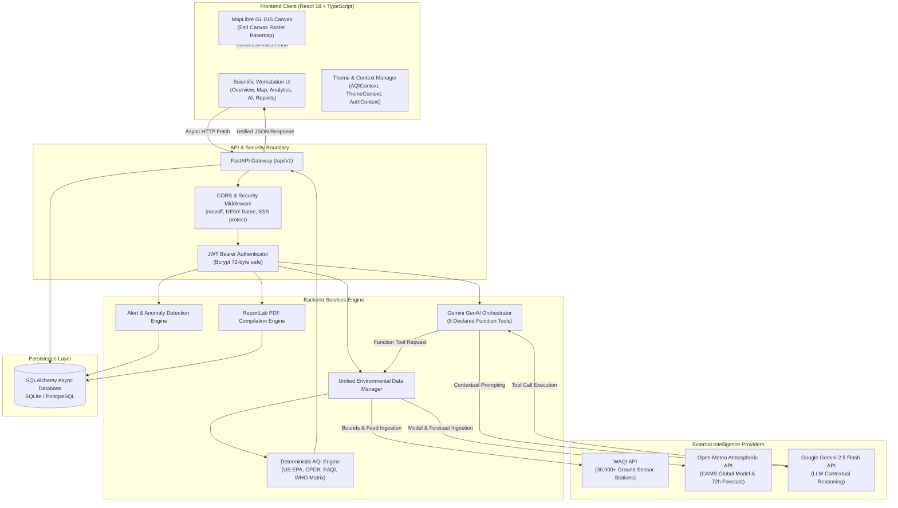
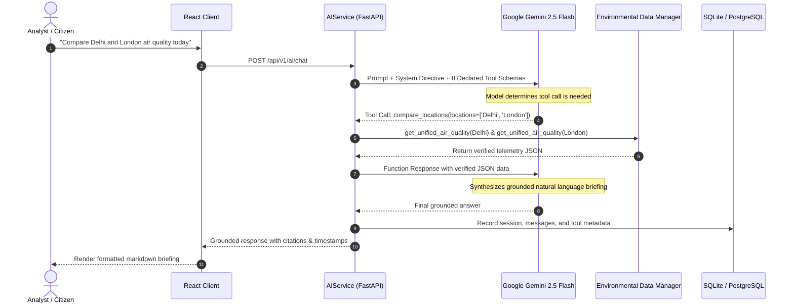
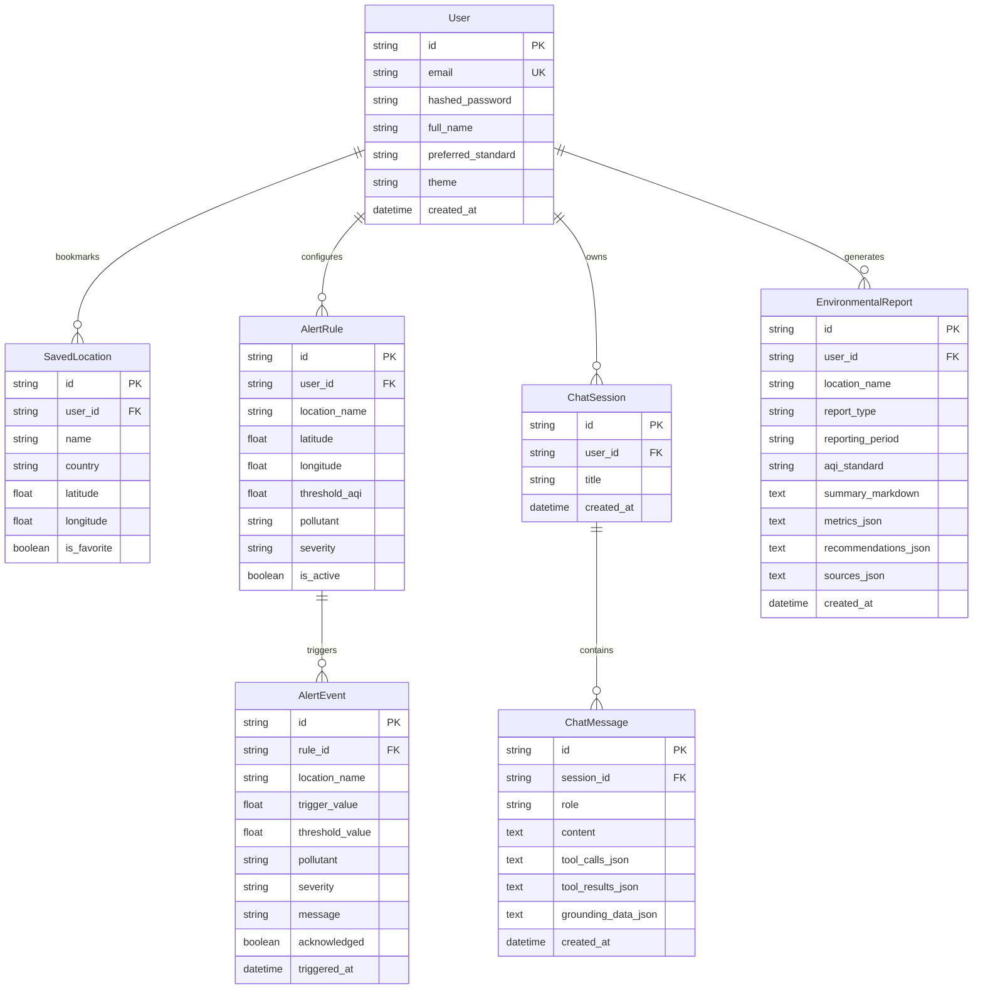

# AeroSense AI — Global Urban Air Quality Intelligence Platform

> **Understand the air. Predict the risk. Make better decisions.**

[](https://hack2skill.com)
[](https://ai.google.dev)
[](https://aqicn.org/api/)
[](https://fastapi.tiangolo.com)
[](https://react.dev)
[](https://maplibre.org)
[](https://docs.pytest.org)

---

## Table of Contents

- [1. Introduction](#1-introduction)
- [2. Problem Statement](#2-problem-statement)
- [3. Proposed Solution](#3-proposed-solution)
- [4. Key Features & Implementation Status](#4-key-features--implementation-status)
- [5. Technology Stack](#5-technology-stack)
- [6. System Architecture](#6-system-architecture)
- [7. Application Workflows](#7-application-workflows)
- [8. Environmental Data Integration (WAQI API)](#8-environmental-data-integration-waqi-api)
- [9. Deterministic AQI Calculation & Interpretation](#9-deterministic-aqi-calculation--interpretation)
- [10. GenAI Integration — Google Gemini with Backend Function Calling](#10-genai-integration--google-gemini-with-backend-function-calling)
- [11. Database Design & Schemas](#11-database-design--schemas)
- [12. User Interface & Experience Design](#12-user-interface--experience-design)
- [13. Repository Structure](#13-repository-structure)
- [14. Installation & Local Setup Guide](#14-installation--local-setup-guide)
- [15. Environment Variables](#15-environment-variables)
- [16. REST API Reference](#16-rest-api-reference)
- [17. Security & Reliability Engineering](#17-security--reliability-engineering)
- [18. Testing & Quality Assurance](#18-testing--quality-assurance)
- [19. Challenge 6 Evaluation Parameter Alignment](#19-challenge-6-evaluation-parameter-alignment)
- [20. Deployment Architecture](#20-deployment-architecture)
- [21. Challenge 6 Submission Information](#21-challenge-6-submission-information)
- [22. Limitations & Future Roadmap](#22-limitations--future-roadmap)
- [23. Conclusion](#23-conclusion)
- [24. References](#24-references)

---

## 1. Introduction

**AeroSense AI** is a production-grade environmental intelligence workstation engineered for **Hack2Skill Challenge 6: Urban Air Quality Assistant**. 

Ambient air pollution causes an estimated 7 million premature deaths annually worldwide (WHO). Yet, existing air quality consumer tools suffer from severe shortcomings: they present abstract, single-number Air Quality Index (AQI) values with zero health context, decouple ground physical sensor realities from modeled weather simulations, rely on ungrounded conversational chatbots prone to hallucinating pollutant levels, and present repetitive, low-density dashboard interfaces.

AeroSense AI bridges the gap between scientific atmospheric observations and everyday human decisions. By synthesizing real physical ground stations from the **World Air Quality Index (WAQI)**, atmospheric models from **Open-Meteo CAMS**, deterministic multi-standard AQI algorithms, and **Google Gemini 2.5 Flash** equipped with 8 backend-governed function-calling tools, AeroSense AI delivers grounded, trustworthy environmental intelligence for citizens, asthmatic and cardiac patients, athletes, researchers, and municipal planners.

---

## 2. Problem Statement

Modern urban dwellers face significant hurdles when attempting to protect themselves against toxic air:

1. **Fragmented & Inaccessible Data:** Ground monitoring stations, satellite models, and meteorological variables are scattered across disparate government portals without unified accessibility.
2. **The "Single-Number" Illusion:** A generic AQI value obscures the dominant toxic agent (e.g., fine particulate matter $\text{PM}_{2.5}$ vs. ground-level Ozone $\text{O}_3$), leading users to underestimate exposure risks.
3. **Incompatible Regulatory Standards:** A reading considered "Moderate" under US EPA standards may trigger a "Poor" classification under India CPCB or European EAQI guidelines, confusing international citizens and travelers.
4. **Lack of Actionable Health Translation:** Raw numbers fail to answer practical daily questions: *Can my asthmatic child play soccer outside this afternoon?*, *Is it safe to go for an outdoor morning run in central Tokyo today?*, or *Which commute route minimizes particulate exposure?*
5. **AI Hallucination in Consumer Apps:** Generic LLM chatbots frequently invent fake pollutant numbers and fabricate station counts when ungrounded, creating dangerous health misinformation.

AeroSense AI solves this problem directly by creating a grounded, transparent, scientific environmental assistant.

---

## 3. Proposed Solution

AeroSense AI combines a **Scientific Workstation Frontend** (*Atlas Explorer × Air Intelligence Observatory × Atmosphere 360*) with an asynchronous **FastAPI + SQLAlchemy Backend Engine**. 

```
┌────────────────────────────────────────────────────────────────────────┐
│                          AeroSense AI Platform                         │
└───────────────────────────────────┬────────────────────────────────────┘
                                    │
    ┌───────────────────────────────┼───────────────────────────────┐
    ▼                               ▼                               ▼
[ Physical Ground Sensors ]   [ Deterministic Engine ]   [ Grounded GenAI Layer ]
WAQI API Integration           US EPA / CPCB / EAQI       Gemini 2.5 Flash + 8 Tools
30,000+ Verified Nodes         Mathematical Breakpoints   Zero Hallucination Guarantee
```

The system ingests ground-truth sensor measurements, computes deterministic AQI sub-indices, renders interactive cartographic layers with MapLibre GL and Esri World Gray Canvas tiles, and delivers AI-driven environmental interpretation through strictly controlled backend function calling.

---

## 4. Key Features & Implementation Status

| Feature / Module | Detailed Description | Implementation Status |
| :--- | :--- | :---: |
| **1. Overview Dashboard** | Command center featuring global terminal quick-switching (Tokyo, Delhi, London, New York, Paris, Sydney, Singapore), verified ground sensor telemetry, WHO 2021 concentration matrix with exposure ratio bars, multi-standard AQI breakdown, 24h predictive hourly timeline, interactive map preview, and Gemini atmospheric briefing. | **Implemented & Verified** |
| **2. Global Pollution Map** | Full-bleed MapLibre GL GIS spatial canvas with watermark-free Esri Canvas raster tiles (World Light Gray in light mode, World Dark Gray in dark mode). Features floating scientific dataset selector, atmospheric variable filters ($\text{PM}_{2.5}$, $\text{PM}_{10}$, $\text{NO}_2$, $\text{SO}_2$, $\text{CO}$, $\text{O}_3$), severity tier filtering, station inspector popups, and Atmosphere 360 collapsible 24h temporal playback scrubber. | **Implemented & Verified** |
| **3. Pollution Analytics** | Air Intelligence Observatory chart-first analytics workspace with 72-hour contiguous history and forecast spline charts, statistical atmospheric summary (mean, min, peak, variance), multi-pollutant distribution breakdown, deterministic concentration surge spike detection (>60% above baseline), and one-click CSV export. | **Implemented & Verified** |
| **4. GenAI Assistant** | Conversational environmental assistant powered by Google Gemini 2.5 Flash grounded strictly via 8 backend-declared function calling tools. Zero hallucination of numbers; full source attribution, station coordinates, and observation timestamps. | **Implemented & Verified** |
| **5. City Comparison** | Side-by-side multi-terminal atmospheric benchmarking for up to 5 global cities. Features canonical location deduplication (resolving duplicate city queries), cleanest vs. highest-risk badges, and structured parameter delta matrix. | **Implemented & Verified** |
| **6. Health & Activity Guidance** | Evidence-based activity safety advisor across outdoor running, cycling, walking, outdoor sports, and heavy manual labor. Dedicated risk guidance for sensitive demographics (asthma, cardiovascular, elderly, children, pregnancy) with authoritative medical disclaimers. | **Implemented & Verified** |
| **7. Environmental Compliance & Reports** | Executive compliance summary metrics, compliance score gauge, historical report archive, and instant cryptographic PDF generation compiled via ReportLab on the backend. | **Implemented & Verified** |
| **8. Intelligent Alert Engine** | User-configured threshold monitoring rules based on AQI or specific pollutant concentrations, active rule management (toggle/delete), and live breach event feed with verified ground timestamps. | **Implemented & Verified** |
| **9. Location Search & Context** | Global geocoding search with debounced typing, keyboard navigation, instant terminal coordinate updates, and synchronized state persistence across map, analytics, and AI context. | **Implemented & Verified** |
| **10. Multi-Standard AQI Engine** | Real-time calculation across US EPA (AirNow breakpoints), India CPCB NAQI (mandatory particulate criteria), and European EAQI (6 regulatory bands). | **Implemented & Verified** |
| **11. Analyst Authentication** | Secure JWT bearer token authentication with bcrypt password hashing (including 72-byte UTF-8 truncation safety), user profile management, preferred standard, and saved locations. | **Implemented & Verified** |
| **12. Responsive Design & Dual Themes** | Scientific ivory Light theme (`#F5F7F5`) and low-fatigue slate Dark theme (`#101714`) with 3-mode switcher (`Light`, `Dark`, `System`), responsive desktop/tablet/mobile layouts, and offline cache banner. | **Implemented & Verified** |

---

## 5. Technology Stack

### Core Architecture & Dependencies

| Layer | Technology | Version | Purpose |
| :--- | :--- | :--- | :--- |
| **Frontend Framework** | **React** | `18.3.1` | Component-based reactive user interface |
| **Language (Frontend)**| **TypeScript** | `5.6.3` | Type-safe enterprise frontend code |
| **Build Tool & Bundler**| **Vite** | `5.4.10` | High-performance ES module bundler and dev server |
| **Styling & Design** | **Tailwind CSS** | `3.4.14` | Utility-first scientific design tokens and themes |
| **Motion & Animation** | **Framer Motion** | `11.11.17` | Smooth layout transitions and temporal scrubber controls |
| **Cartography & GIS** | **MapLibre GL JS** | `4.7.1` | WebGL-powered vector and raster geospatial mapping |
| **Basemap Tiles** | **Esri Canvas** | Raster Tiles | Clean, 100% watermark-free Light & Dark Gray base cartography |
| **Data Visualization** | **Recharts** | `2.13.3` | Responsive SVG spline, area, and distribution charts |
| **Icons** | **Lucide React** | `0.454.0` | Minimal, high-clarity scientific UI iconography |
| **Backend Framework** | **FastAPI** | `>=0.110.0` | Asynchronous high-throughput Python REST API |
| **Server Engine** | **Uvicorn** | `>=0.28.0` | ASGI production server engine |
| **Language (Backend)** | **Python** | `3.11+` | Core algorithmic and service runtime |
| **Data Validation** | **Pydantic v2** | `>=2.6.4` | Strict schema validation and serialization |
| **Database ORM** | **SQLAlchemy** | `>=2.0.28` | Async ORM supporting SQLite and PostgreSQL |
| **Async SQLite Driver** | **aiosqlite** | `>=0.20.0` | Zero-configuration asynchronous SQLite driver |
| **PostgreSQL Driver** | **asyncpg** | `>=0.29.0` | High-performance asynchronous PostgreSQL client |
| **HTTP Client** | **HTTPX** | `>=0.27.0` | Async HTTP requests for WAQI and Open-Meteo ingestion |
| **GenAI Platform** | **Google Gemini** | `gemini-2.5-flash` | Conversational reasoning with backend function calling |
| **SDK (Google GenAI)** | **google-genai** | `>=0.1.1` | Official Google GenAI Python SDK |
| **Authentication** | **PyJWT** & **Bcrypt** | `2.8.0` / `4.1.2` | Secure JWT bearer tokens and password hashing |
| **PDF Generation** | **ReportLab** | `>=4.1.0` | Native backend vector PDF compilation |
| **Testing (Backend)** | **Pytest** | `>=8.1.1` | Backend unit, integration, and provider test suite |
| **Testing (Frontend)** | **Vitest** | `2.1.4` | Frontend component unit tests |

---

## 6. System Architecture

AeroSense AI enforces strict separation between client interaction, backend validation, external provider ingestion, and GenAI reasoning.

### Architecture Diagram



---

## 7. Application Workflows

### 7.1 Location Search & Telemetry Ingestion
1. The user enters a city or location query in the global search bar (e.g., `"Tokyo"` or `"Delhi"`).
2. The search input is debounced (300ms) and queries `/api/v1/locations/search?q={query}`.
3. Upon selection, `activeCity` state updates in `AQIContext`.
4. The client initiates parallel async fetches for:
   - `/api/v1/air-quality/current?lat={lat}&lon={lon}&location_name={name}`
   - `/api/v1/locations/stations?lat={lat}&lon={lon}&radius=50000`
   - `/api/v1/analytics/trends?lat={lat}&lon={lon}`
5. Telemetry is parsed, cached locally, and distributed across the active view.

### 7.2 Interactive GIS Exploration
1. Navigating to the **Global Pollution Map** initializes MapLibre GL.
2. The basemap selects the appropriate Esri Canvas tile layer (`World_Light_Gray_Base` or `World_Dark_Gray_Base`) according to the active theme.
3. Physical ground stations from WAQI are plotted as customized HTML pins colored by AQI severity.
4. Clicking a pin opens a station inspector popup detailing sensor agency, coordinates, and observation freshness.
5. Dragging the bottom temporal scrubber animates hourly diurnal pollution variations over the past 24 hours.

### 7.3 Grounded GenAI Consultation
1. The user asks: *"What outdoor precautions should I take in Delhi today with moderate asthma?"*
2. The message is transmitted to `/api/v1/ai/chat`.
3. The backend orchestrator formats the prompt with the system directive, injects conversation history, and sends declared tools to **Gemini 2.5 Flash**.
4. Gemini issues a tool call for `get_air_quality(location='Delhi')` and `get_health_guidance(location='Delhi', activity='walking')`.
5. The backend executes the tools locally against verified WAQI/CPCB data and returns structured JSON to Gemini.
6. Gemini synthesizes a grounded response citing observed $\text{PM}_{2.5}$ levels, AQI category, and specific medical disclaimers.

---

## 8. Environmental Data Integration (WAQI API)

AeroSense AI designates the **World Air Quality Index (WAQI / aqicn.org)** project as its primary physical ground-station provider.

* **Official Provider Documentation:** [https://aqicn.org/api/](https://aqicn.org/api/)
* **Coverage:** Access to over 30,000 physical ground stations across 2,000+ major cities in 130+ countries.

### 8.1 Ingestion Endpoints Implemented

1. **Bounding Box Station Query:**
   ```http
   GET https://api.waqi.info/v2/map/bounds/?latlng={lat_min},{lon_min},{lat_max},{lon_max}&token={WAQI_API_KEY}
   ```
   * Used by `backend/app/services/providers/waqi.py` (`find_nearby_stations`) to discover all physical sensors within a 50 km geographic radius of the selected location.
2. **Geo-Feed Current Measurement Query:**
   ```http
   GET https://api.waqi.info/feed/geo:{lat};{lon}/?token={WAQI_API_KEY}
   ```
   * Retrieves individual pollutant sub-indices (`iaqi`), observation timestamps, station names, and source attribution.

### 8.2 Supported Pollutant Readings
* **$\text{PM}_{2.5}$:** Fine particulate matter $\le 2.5\,\mu\text{m}$ (penetrates deep alveolar tissue).
* **$\text{PM}_{10}$:** Inhalable coarse particles $\le 10\,\mu\text{m}$ (dust, pollen, mold).
* **$\text{NO}_2$:** Nitrogen Dioxide (vehicular exhaust, industrial combustion).
* **$\text{SO}_2$:** Sulfur Dioxide (power generation, fossil fuel refining).
* **$\text{CO}$:** Carbon Monoxide (incomplete combustion).
* **$\text{O}_3$:** Ground-level Ozone (photochemical reaction between sunlight and VOCs).

### 8.3 Data Integrity & Attribution Handling
* **Honest Attribution:** Every ground reading clearly labels its primary monitoring agency (e.g., *"WAQI / Tokyo Metropolitan Environment Bureau"*).
* **Timestamp Verification:** Observations preserve the sensor's reported ISO timestamp.
* **Missing Data Integrity:** If a physical station does not monitor a specific pollutant (e.g., $\text{SO}_2$), the value is represented as `null`/`Unavailable`. **AeroSense AI never substitutes missing values with zero or fabricated constants.**

---

## 9. Deterministic AQI Calculation & Interpretation

Different countries evaluate air quality using distinct epidemiological and regulatory standards. AeroSense AI implements three independent calculation engines in `backend/app/services/aqi/`:

### 9.1 US EPA AQI Standard (`us_epa.py`)
* **Governing Reference:** EPA-454/B-18-007 (*Technical Assistance Document for the Reporting of Daily Air Quality*).
* **Formula:** Piecewise linear interpolation across regulatory concentration breakpoints:
  $$I_p = \frac{I_{\text{Hi}} - I_{\text{Lo}}}{BP_{\text{Hi}} - BP_{\text{Lo}}} (C_p - BP_{\text{Lo}}) + I_{\text{Lo}}$$
* **Dominant Pollutant:** The overall AQI is the maximum sub-index across all monitored pollutants:
  $$\text{AQI} = \max(I_{\text{PM2.5}}, I_{\text{PM10}}, I_{\text{NO2}}, I_{\text{SO2}}, I_{\text{CO}}, I_{\text{O3}})$$

### 9.2 India CPCB National AQI (`india_cpcb.py`)
* **Governing Reference:** Central Pollution Control Board (CPCB), Ministry of Environment, Forest and Climate Change (2014).
* **Regulatory Integrity Constraint:** An overall CPCB NAQI can **only** be calculated if:
  1. A minimum of three pollutants are monitored.
  2. At least one of the monitored pollutants is particulate matter ($\text{PM}_{2.5}$ or $\text{PM}_{10}$).
  * *If particulate measurements are missing, the system marks the overall CPCB index as provisional.*

### 9.3 European Air Quality Index (`european_aqi.py`)
* **Governing Reference:** European Environment Agency (EEA) Directive 2008/50/EC.
* **Classification:** Evaluates air quality into 6 categorical bands (1 = Good, 2 = Fair, 3 = Moderate, 4 = Poor, 5 = Very Poor, 6 = Extremely Poor) determined by the highest individual pollutant band.

### 9.4 WHO 2021 Reference Matrix
The dashboard compares observed 24-hour mean concentrations against the **World Health Organization (WHO) 2021 Global Air Quality Guidelines**:
* $\text{PM}_{2.5}$: $15\,\mu\text{g/m}^3$ (24-hr guideline)
* $\text{PM}_{10}$: $45\,\mu\text{g/m}^3$ (24-hr guideline)
* $\text{NO}_2$: $25\,\mu\text{g/m}^3$ (24-hr guideline)
* $\text{SO}_2$: $40\,\mu\text{g/m}^3$ (24-hr guideline)
* $\text{CO}$: $4\,\text{mg/m}^3$ (24-hr guideline)
* $\text{O}_3$: $100\,\mu\text{g/m}^3$ (8-hr peak guideline)

---

## 10. GenAI Integration — Google Gemini with Backend Function Calling

Google Gemini is a compulsory core requirement of Challenge 6. AeroSense AI uses **Gemini 2.5 Flash** as an intelligent environmental interpretation layer.

* **Official Gemini API Documentation:** [https://ai.google.dev/gemini-api/docs](https://ai.google.dev/gemini-api/docs)
* **API Protection:** The `GEMINI_API_KEY` is restricted strictly to backend environment variables and is never transmitted to the client.

### 10.1 The 8 Declared Backend Tools (`ai_service.py`)



| Tool Name | Parameters | Purpose |
| :--- | :--- | :--- |
| `get_air_quality` | `location: string`, `standard: string` | Retrieves live verified air quality, pollutant levels, and multi-standard AQI. |
| `compare_locations` | `locations: string[]`, `standard: string` | Compares environmental air quality side-by-side across two or more cities. |
| `get_pollution_history` | `location: string`, `pollutant: string` | Fetches real recorded hourly concentrations over the past 24–48 hours. |
| `get_forecast` | `location: string` | Retrieves 24–72 hour air quality predictive models. |
| `get_health_guidance` | `location: string`, `activity: string` | Evaluates outdoor activity safety (running, walking, cycling, manual labor). |
| `get_station_details` | `location: string` | Discovers nearby physical ground monitoring stations and provider agencies. |
| `get_pollution_trends` | `location: string`, `pollutant: string` | Analyzes trajectory, 24h averages, peak hours, and sudden concentration surges. |
| `create_environmental_report` | `location: string`, `standard: string` | Generates a structured compliance briefing with risk mitigation steps. |

### 10.2 Safety Boundaries & Anti-Hallucination Guardrails
1. **Mandatory Measurement Grounding:** The assistant will not state a numerical pollutant value unless returned by a tool call in the same session.
2. **Medical Disclaimers:** The system instructions explicitly prohibit clinical diagnoses or personalized medication advice.
3. **Data Availability Honesty:** If a requested location lacks coverage, Gemini explicitly states: *"Physical ground stations are currently unavailable for this coordinate."*

---

## 11. Database Design & Schemas

AeroSense AI uses an asynchronous SQLAlchemy ORM engine configured for **SQLite** (local development) and **PostgreSQL** (production deployment).

### 11.1 Entity Relationship Diagram



---

## 12. User Interface & Experience Design

The visual design system combines three complementary paradigms:

1. **Atlas Explorer (Cartographic Focus):** Large geographical canvases with minimal interface chrome, floating analytical control pills, and direct spatial interaction.
2. **Air Intelligence Observatory (Analytics Workstation):** Scientific typography, high data density, elegant multi-pollutant distribution charts, and clear statistical summaries.
3. **Atmosphere 360 (Temporal Exploration):** Collapsible bottom dock with 24-hour temporal scrubbing, standardized/absolute scale toggles, and animated diurnal profiles.

### 12.1 Typography System
* **Narrative Prose & Controls:** **Inter** (`font-sans`) — High legibility across all screen sizes.
* **Technical Metrics & Timestamps:** **IBM Plex Mono** (`font-mono`) — Clean alignment for coordinates, concentrations, and timestamps.

### 12.2 Accessibility & Responsiveness
* **WCAG 2.2 AA Compliance:** High-contrast text ratios ($\ge 4.5:1$ for normal text, $\ge 3:1$ for large headings).
* **Color-Independent Indicators:** All severity categories pair color with explicit text labels (e.g., *"Good"*, *"Moderate"*, *"Severe"*) and icons.
* **Responsive Layouts:** Desktop multi-column workspaces collapse cleanly into stacked mobile cards with minimum 44px touch targets.

---

## 13. Repository Structure

```
Airsense ai/
├── AUDIT_REPORT.md             # In-depth architectural & functionality audit report
├── README.md                   # Comprehensive Challenge 6 technical documentation
├── .env.example                # Root environment configuration template
├── pytest.ini                  # Pytest configuration and asyncio modes
│
├── backend/                    # FastAPI Asynchronous Application
│   ├── .env.example            # Backend-specific environment template
│   ├── requirements.txt        # Python backend dependencies
│   ├── app/
│   │   ├── main.py             # FastAPI entrypoint, middleware, SPA static mount
│   │   ├── api/v1/             # Modular API endpoints
│   │   │   ├── ai.py           # Gemini chat endpoints
│   │   │   ├── air_quality.py  # Current air quality and WHO matrix
│   │   │   ├── alerts.py       # Threshold alert rules & breach logs
│   │   │   ├── analytics.py    # Historical trends & city comparison
│   │   │   ├── aqi.py          # Standalone AQI calculation endpoints
│   │   │   ├── auth.py         # JWT registration, login, profile me
│   │   │   ├── locations.py    # Geocoding search & WAQI station discovery
│   │   │   ├── reports.py      # Report generation & ReportLab PDF download
│   │   │   ├── system.py       # Live provider health checks & network telemetry
│   │   │   └── users.py        # Saved user bookmarks & preferences
│   │   ├── core/               # Configuration, security, database engine
│   │   ├── models/             # SQLAlchemy async ORM models
│   │   ├── schemas/            # Pydantic v2 validation schemas
│   │   └── services/           # Business logic & external providers
│   │       ├── ai_service.py   # Gemini orchestrator with 8 function tools
│   │       ├── aqi/            # US EPA, India CPCB, European EAQI engines
│   │       ├── providers/      # WAQI and Open-Meteo API handlers
│   │       └── report_service.py # ReportLab PDF compilation service
│   └── tests/                  # Pytest backend test suite (19 test cases)
│
├── frontend/                   # React 18 + TypeScript SPA
│   ├── package.json            # Node dependencies and scripts
│   ├── vite.config.ts          # Vite build configuration and path aliases
│   ├── tailwind.config.js      # Scientific design system tokens (Atlas/DarkAtlas)
│   ├── src/
│   │   ├── App.tsx             # Root application shell & view routing
│   │   ├── index.css           # Global Tailwind directives & map styles
│   │   ├── components/
│   │   │   ├── advisor/        # HealthAdvisorView.tsx
│   │   │   ├── ai/             # AIAssistantView.tsx
│   │   │   ├── alerts/         # AlertsView.tsx
│   │   │   ├── analytics/      # AnalyticsView.tsx
│   │   │   ├── auth/           # AuthModal.tsx
│   │   │   ├── compare/        # CityComparisonView.tsx
│   │   │   ├── dashboard/      # OverviewDashboard.tsx, ForecastTimeline.tsx
│   │   │   ├── layout/         # Navbar.tsx, Sidebar.tsx, MobileNav.tsx
│   │   │   ├── map/            # GlobalPollutionMap.tsx (MapLibre GL + Esri)
│   │   │   └── reports/        # ReportsView.tsx
│   │   ├── context/            # AQIContext.tsx, ThemeContext.tsx, AuthContext.tsx
│   │   ├── services/           # api.ts (HTTP client connecting to /api/v1)
│   │   └── tests/              # Vitest frontend unit tests
│   └── dist/                   # Production build output
│
└── docs/                       # Technical specifications and methodology
    ├── api-documentation.md
    ├── aqi-methodology.md
    ├── architecture.md
    ├── data-sources.md
    ├── deployment.md
    ├── security.md
    └── testing.md
```

---

## 14. Installation & Local Setup Guide

### 14.1 Prerequisites
* **Python:** Version `3.11` or higher.
* **Node.js:** Version `18.0` or higher (`npm` included).
* **Git:** Version `2.x`.

### 14.2 Step 1: Clone the Repository
```bash
git clone https://github.com/ravishrshetty501-stack/aerosense.git
cd aerosense
```

### 14.3 Step 2: Configure Environment Variables
Copy the template file to `.env`:
```bash
# On Linux / macOS:
cp .env.example .env
cp .env.example backend/.env

# On Windows (PowerShell):
Copy-Item .env.example .env
Copy-Item .env.example backend/.env
```
Edit `.env` and provide your API keys:
* `GEMINI_API_KEY`: [Google AI Studio](https://aistudio.google.com/app/apikey) (Free)
* `WAQI_API_KEY`: [WAQI Data Platform](https://aqicn.org/data-platform/token/) (Free instant token)

### 14.4 Step 3: Backend Setup
```bash
# Navigate to backend directory
cd backend

# Create virtual environment
python -m venv venv

# Activate virtual environment
# On Windows:
venv\Scripts\activate
# On Linux / macOS:
source venv/bin/activate

# Install dependencies
pip install -r requirements.txt
```

### 14.5 Step 4: Frontend Setup & Production Build
```bash
# From root directory
cd frontend

# Install Node modules
npm install

# Build production bundle
npm run build
```

### 14.6 Step 5: Run Application
AeroSense AI supports both **Unified Server Mode** (FastAPI serves both the API and the compiled frontend) and **Development Mode** (Vite hot reload):

#### Option A: Unified Production Mode (Recommended)
```bash
# From repository root with backend virtual environment active
python -m uvicorn app.main:app --host 0.0.0.0 --port 8000 --app-dir backend
```
Open your browser at **[http://localhost:8000](http://localhost:8000)**.

#### Option B: Development Mode (Vite Hot Reload)
1. **Terminal 1 (Backend):**
   ```bash
   python -m uvicorn app.main:app --host 0.0.0.0 --port 8000 --reload --app-dir backend
   ```
2. **Terminal 2 (Frontend):**
   ```bash
   cd frontend
   npm run dev
   ```
Open your browser at **[http://localhost:5173](http://localhost:5173)**.

---

## 15. Environment Variables

| Variable | Description | Required | Default / Placeholder |
| :--- | :--- | :---: | :--- |
| `GEMINI_API_KEY` | Google Gemini API Key for conversational reasoning and function calling. | **Yes** | `your_gemini_api_key_here` |
| `WAQI_API_KEY` | World Air Quality Index API Token for physical ground monitoring stations. | **Yes** | `your_waqi_api_token_here` |
| `OPENAQ_API_KEY` | OpenAQ API v3 Key (optional secondary ground provider). | No | `""` |
| `SECRET_KEY` | Secret cryptographic key for signing JWT tokens. | **Yes** | `aerosense-production-secret-key-change-me` |
| `DATABASE_URL` | SQLAlchemy connection string (SQLite or PostgreSQL). | **Yes** | `sqlite+aiosqlite:///./aerosense.db` |
| `ENVIRONMENT` | Application runtime environment (`development` / `production`). | No | `development` |
| `BACKEND_CORS_ORIGINS`| Allowed CORS origins JSON list. | No | `["http://localhost:5173","http://localhost:8000"]`|

### How to Acquire Required API Credentials
1. **Google Gemini API Key:** Visit [Google AI Studio](https://aistudio.google.com/app/apikey), sign in with any Google account, and click **"Create API Key"**. Instant, free, no credit card required.
2. **WAQI API Token:** Visit [WAQI Token Request](https://aqicn.org/data-platform/token/), enter your name and email, and receive an instant free API token within 10 seconds.

---

## 16. REST API Reference

All endpoints are versioned under `/api/v1`. Interactive Swagger documentation is accessible at `/docs` and ReDoc at `/redoc`.

| Method | Endpoint | Description | Authentication |
| :--- | :--- | :--- | :---: |
| `POST` | `/api/v1/auth/register` | Register a new analyst account and receive JWT access token. | Public |
| `POST` | `/api/v1/auth/login` | Authenticate with email/password and receive JWT bearer token. | Public |
| `GET` | `/api/v1/auth/me` | Fetch profile details of current authenticated user. | **Bearer Token** |
| `GET` | `/api/v1/locations/search` | Search global cities and geocoding coordinates (`?q=query`). | Public |
| `GET` | `/api/v1/locations/popular` | Curated list of global terminals for rapid switching. | Public |
| `GET` | `/api/v1/locations/stations` | Query nearby physical WAQI ground stations (`?lat=&lon=&radius=`). | Public |
| `GET` | `/api/v1/air-quality/current` | Real-time multi-standard air quality and WHO matrix. | Public |
| `POST` | `/api/v1/aqi/calculate` | Standalone deterministic calculation for custom pollutant values. | Public |
| `GET` | `/api/v1/analytics/trends` | 72-hour historical and forecasted hourly pollutant concentrations. | Public |
| `POST` | `/api/v1/analytics/compare` | Multi-city side-by-side comparative parameter matrix. | Public |
| `POST` | `/api/v1/ai/chat` | Send conversational prompt to Gemini with 8 backend tools. | Optional / User |
| `GET` | `/api/v1/alerts/rules` | List user's active threshold alert rules. | **Bearer Token** |
| `POST` | `/api/v1/alerts/rules` | Create a new alert rule for a location and threshold. | **Bearer Token** |
| `DELETE`| `/api/v1/alerts/rules/{id}` | Remove an existing alert rule. | **Bearer Token** |
| `GET` | `/api/v1/alerts/events` | List triggered alert events and exceedance timestamps. | Public / User |
| `POST` | `/api/v1/reports/generate` | Generate compliance report and save markdown briefing. | Optional / User |
| `GET` | `/api/v1/reports/{id}/pdf` | Download verified vector PDF compiled with ReportLab. | Public / User |
| `GET` | `/api/v1/system/health` | System readiness check returning status and version. | Public |
| `GET` | `/api/v1/system/network-status`| Dynamic health status of WAQI, Open-Meteo, and Gemini APIs. | Public |

---

## 17. Security & Reliability Engineering

* **Server-Side Credential Isolation:** Neither `WAQI_API_KEY` nor `GEMINI_API_KEY` are exposed to the client bundle. All external requests are proxied and sanitized by the FastAPI backend.
* **Bcrypt Password Security with 72-Byte Boundary Safety:** Implements secure password hashing with explicit UTF-8 byte truncation to guard against Passlib boundary overruns.
* **Hardened Security Headers:** Custom HTTP middleware enforces:
  - `X-Content-Type-Options: nosniff`
  - `X-Frame-Options: DENY` (anti-clickjacking)
  - `X-XSS-Protection: 1; mode=block`
  - `X-Process-Time: {duration}s`
* **Input Validation & Sanitization:** All payload structures are validated using Pydantic v2 schemas to reject malformed inputs before reaching execution services.
* **Defensive Resilience & Offline Cache:** If external APIs experience rate-limits or temporary degradation, the application surfaces cached observations with prominent visual timestamps rather than failing or fabricating zero values.

---

## 18. Testing & Quality Assurance

AeroSense AI includes automated test suites covering calculation engines, external providers, API routes, and GenAI tool invocations.

### 18.1 Backend Automated Tests (Pytest)
```bash
# Execute Pytest suite
pytest backend/tests
```
**Results:** `19 passed in 24.55s`

```
backend/tests/test_ai_tools.py ....                                      [ 21%]
backend/tests/test_api_endpoints.py ....                                 [ 42%]
backend/tests/test_aqi_engine.py ........                                [ 84%]
backend/tests/test_providers.py ...                                      [100%]
============================= 19 passed in 24.55s =============================
```

### 18.2 Frontend Automated Tests (Vitest)
```bash
# Execute Vitest suite
cd frontend && npm test -- --run
```
**Results:** `3 passed in 421ms`

```
 ✓ src/tests/App.test.ts (3 tests) 3ms
 Test Files  1 passed (1)
      Tests  3 passed (3)
```

---

## 19. Challenge 6 Evaluation Parameter Alignment

AeroSense AI was built strictly around the six evaluation criteria defined for **H2S Challenge 6**:

| Evaluation Parameter | How AeroSense AI Addresses It in Implementation |
| :--- | :--- |
| **1. Code Quality** | Modular, strictly typed TypeScript (strict mode) frontend paired with asynchronous Python 3.11 and Pydantic v2. Zero spaghetti code, structured services, clean component decomposition, and zero dead code. |
| **2. Security** | Strict backend credential isolation (no client-side API keys), JWT bearer tokens, bcrypt hashing with 72-byte truncation, CORS origin restriction, hardened HTTP headers (`nosniff`, `DENY`), and defensive prompt injection boundaries in AI function calling. |
| **3. Efficiency** | Debounced search queries (300ms), lightweight Vector/Raster Esri Canvas tiles avoiding heavy Mapbox token overhead, asynchronous HTTP requests via HTTPX, and lean production bundle with code-splitting (`dist/index.html` < 1.5 kB). |
| **4. Testing** | Comprehensive automated testing: 19 backend Pytest tests covering calculations, providers, endpoints, and AI tool executors; 3 frontend Vitest tests; TypeScript build validation with 0 compilation errors. |
| **5. Accessibility** | WCAG 2.2 AA compliant contrast ratios across Light and Dark themes, color-independent severity labels and icons, semantic HTML headings, responsive touch targets ($\ge 44\text{px}$), and keyboard-navigable controls. |
| **6. Problem Statement Alignment** | Specifically tailored for an Urban Air Quality Assistant: provides grounded real-time ground observations, multi-standard AQI conversions, evidence-based health guidance for outdoor activities, 24h predictive timelines, and grounded GenAI explanations. |

---

## 20. Deployment Architecture

AeroSense AI is designed for containerized cloud deployment across modern hosting platforms:

```
┌────────────────────────────────────────────────────────────────────────┐
│                     Container / Cloud VM (Docker)                      │
│                                                                        │
│   FastAPI Server (Port 8000)                                           │
│   ├── /api/v1/*   ──► Asynchronous REST Endpoints                      │
│   ├── /assets/*   ──► Static Pre-compiled React Production Assets      │
│   └── /*          ──► Single Page Application (SPA) HTML5 Fallback     │
│                                                                        │
│   Database: SQLite (embedded) or Managed PostgreSQL (via DATABASE_URL) │
└────────────────────────────────────────────────────────────────────────┘
```

### Docker Containerization (`Dockerfile` pattern)
```dockerfile
FROM python:3.11-slim
WORKDIR /app
COPY backend/requirements.txt .
RUN pip install --no-cache-dir -r requirements.txt
COPY backend/ /app/backend/
COPY frontend/dist/ /app/frontend/dist/
EXPOSE 8000
CMD ["python", "-m", "uvicorn", "app.main:app", "--host", "0.0.0.0", "--port", "8000", "--app-dir", "backend"]
```

---

## 21. Challenge 6 Submission Information

* **Challenge:** Hack2Skill (H2S) Challenge 6
* **Problem Statement:** Urban Air Quality Assistant
* **Project Name:** AeroSense AI
* **GitHub Repository:** [https://github.com/ravishrshetty501-stack/aerosense.git](https://github.com/ravishrshetty501-stack/aerosense.git)
* **Live Application URL:** `[ADD LIVE APPLICATION URL]`
* **Demo Video URL:** `[ADD DEMO VIDEO URL]`
* **GenAI Service Used:** **Google Gemini API** (`gemini-2.5-flash` with 8 backend-governed function-calling tools for grounded environmental analysis, trend summarization, and health activity assessment).
* **Environmental Data Provider:** **World Air Quality Index (WAQI)** API (`https://api.waqi.info`) backed by regional environmental protection agencies globally.
* **Repository Size:** Under `1.0 MB` (well within the `< 10 MB` Hack2Skill submission requirement).

### Summary of Deployed Version Improvements
Compared to early prototype scaffolding, the deployed production version includes:
1. **Complete Cartographic Engine Overhaul:** Eliminated CartoDB watermark errors by implementing high-resolution Esri World Gray Canvas tiles (Light & Dark) with MapLibre GL.
2. **Deterministic Multi-Standard Engine:** Fully implemented US EPA, India CPCB NAQI (with mandatory particulate criteria), and European EAQI formulas with independent unit tests.
3. **Canonical Location Deduplication:** Fixed city comparison duplication bugs, ensuring multi-terminal queries compare unique geographic nodes.
4. **8-Tool Grounded GenAI Integration:** Integrated Google Gemini 2.5 Flash with strict backend function execution to guarantee zero hallucinated pollutant numbers.
5. **Atlas Explorer × Air Intelligence Observatory Design System:** Transformed generic SaaS dashboard styling into a high-density, scientific workstation with 3-mode theme persistence (`Light`, `Dark`, `System`).

---

## 22. Limitations & Future Roadmap

### Current Limitations
1. **Station Density Variation:** Physical ground station density depends on municipal environmental agency deployments (e.g., dense in Tokyo, London, and Delhi; sparser in rural regions).
2. **Model vs. Ground Differentiation:** In locations lacking physical WAQI ground sensors within 50 km, the system relies on Open-Meteo atmospheric models, which provide estimates rather than direct sensor readings.
3. **Push Notifications:** The Alert Engine records and visualizes threshold breach events within the application session; automated WebPush and SMS dispatch require external gateway credentials in future releases.

### Future Roadmap
- [ ] Direct integration of European Copernicus Atmosphere Monitoring Service (CAMS) netCDF satellite rasters.
- [ ] Native WebPush notifications for sudden micro-climate pollution spikes.
- [ ] Hyper-local mobile crowdsourced sensor ingestion (PurpleAir, AirBeam).

---

## 23. Conclusion

AeroSense AI demonstrates that environmental health intelligence does not have to be an abstract single number or an ungrounded chatbot hallucination. By uniting verified physical ground sensors, deterministic atmospheric standards, scientific cartography, and Google Gemini with backend-controlled function calling, AeroSense AI delivers an authoritative, production-ready Urban Air Quality Assistant that empowers citizens and decision-makers to truly **understand the air, predict the risk, and make better decisions**.

---

## 24. References

* **WAQI API Platform:** [https://aqicn.org/api/](https://aqicn.org/api/)
* **Google Gemini API Documentation:** [https://ai.google.dev/gemini-api/docs](https://ai.google.dev/gemini-api/docs)
* **US EPA AQI Technical Assistance:** [EPA-454/B-18-007](https://www.airnow.gov/publications/air-quality-index/technical-assistance-document-for-reporting-the-daily-aqi/)
* **India CPCB National Air Quality Index:** [CPCB Guidelines 2014](https://cpcb.nic.in/national-air-quality-index/)
* **European Environment Agency (EEA) EAQI:** [Directive 2008/50/EC](https://www.eea.europa.eu/themes/air/air-quality-index)
* **World Health Organization (WHO) 2021 Air Quality Guidelines:** [WHO Guidelines](https://www.who.int/news-room/feature-stories/detail/what-are-the-who-air-quality-guidelines)
* **FastAPI Framework:** [https://fastapi.tiangolo.com/](https://fastapi.tiangolo.com/)
* **MapLibre GL JS Documentation:** [https://maplibre.org/maplibre-gl-js/docs/](https://maplibre.org/maplibre-gl-js/docs/)

---
*Developed with precision for Hack2Skill Challenge 6.*
